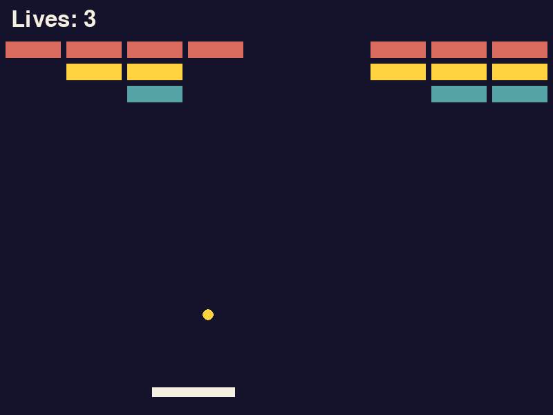
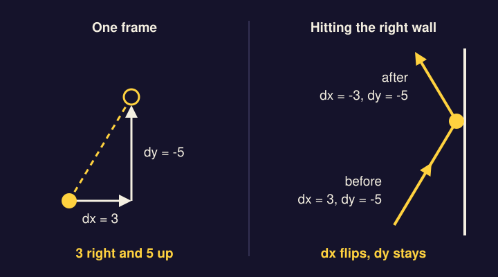
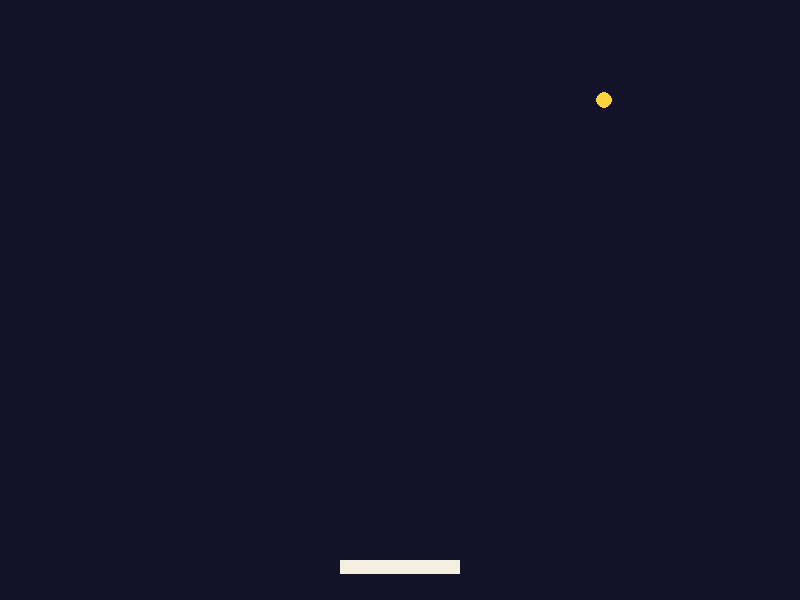
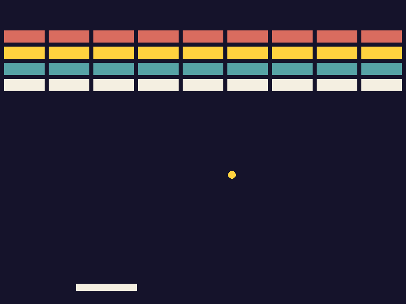
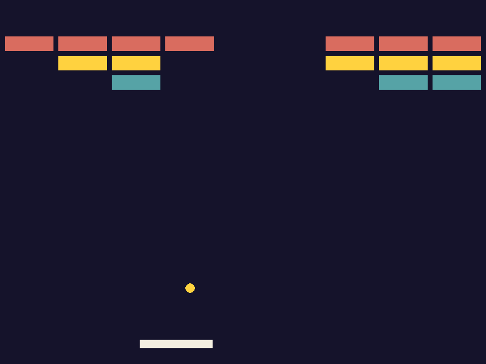
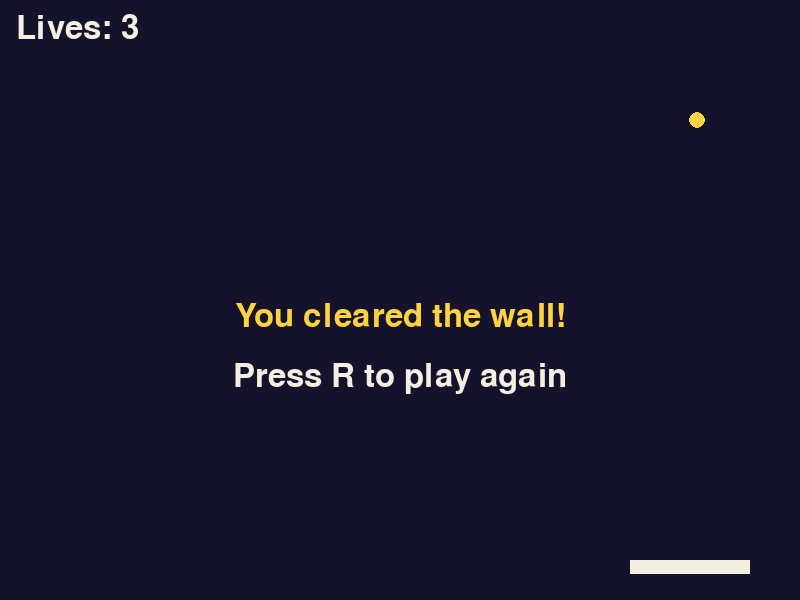

*The finished game. The bottom row is already gone and the ball has broken through the middle.*

In Rain Dodge the drops only moved one way: straight down. In this lesson one thing moves in any direction and bounces off whatever it touches. You'll give the ball a speed made of two numbers, bounce it by changing the sign of one of them, build a wall of bricks with two loops, one inside the other, and end the game in two different ways.

There is nothing to download. Everything on screen is drawn with `pygame.draw`.

Make a folder called `brick-buster` with an empty `main.py` in it, and open a terminal in that folder. You'll type the game loop again from nothing. That is deliberate: it's the same loop you wrote in Rain Dodge, and by now you should be able to write most of it from memory. Try typing step 1 without looking, then compare.

## 1. A window and a paddle

Nothing in this step is new. The window, the loop and the `X` button are the ones from Rain Dodge. The paddle is a `Rect` moved with held keys, and `move_paddle` is Rain Dodge's `move_player` with the names changed. The only difference is the background: there's no picture this time, so `WIN.fill(INDIGO)` paints the whole window one color at the start of every frame.

```python title="main.py" showLineNumbers file=brick-buster/step1.py
import pygame

pygame.init()
WIDTH, HEIGHT = 800, 600
WIN = pygame.display.set_mode((WIDTH, HEIGHT))
pygame.display.set_caption("Brick Buster")
CLOCK = pygame.time.Clock()

INDIGO = (21, 19, 43)
CREAM = (244, 239, 225)
GOLD = (255, 210, 63)

PADDLE_W, PADDLE_H = 120, 14
PADDLE_VEL = 10

def move_paddle(paddle):
    keys = pygame.key.get_pressed()
    if keys[pygame.K_LEFT] and paddle.left - PADDLE_VEL >= 0:
        paddle.x -= PADDLE_VEL
    if keys[pygame.K_RIGHT] and paddle.right + PADDLE_VEL <= WIDTH:
        paddle.x += PADDLE_VEL

def draw(paddle):
    WIN.fill(INDIGO)
    pygame.draw.rect(WIN, CREAM, paddle)
    pygame.display.update()

def main():
    paddle = pygame.Rect(340, 560, PADDLE_W, PADDLE_H)
    while True:
        CLOCK.tick(60)
        for event in pygame.event.get():
            if event.type == pygame.QUIT:
                return
        move_paddle(paddle)
        draw(paddle)

main()
pygame.quit()
```

On line 29 the paddle starts at x 340 because the window is 800 wide and the paddle is 120 wide, which leaves 340 on each side. `GOLD` isn't used yet. It's the ball's color in step 2.

:::tip[Checkpoint 1]
Run `py main.py` (Windows) or `python3 main.py` (Mac). A dark window opens with a cream paddle near the bottom. The left and right arrow keys slide it, and it stops at both edges.


| If this happens | Do this |
| --- | --- |
| `NameError: name 'INDIGO' is not defined` | Line 9 is missing or spelled differently from line 24. Names have to match exactly, capitals included. |
| `TypeError: draw() missing 1 required positional argument: 'paddle'` | Line 36 should be `draw(paddle)`, not `draw()`. |
| The paddle doesn't move | Click the game window first. Then check that `move_paddle(paddle)` on line 35 is inside the `while` loop, lined up with `draw(paddle)`. |
| The paddle leaves a cream smear behind it | Line 24, `WIN.fill(INDIGO)`, is missing. Without it the old frames are never painted over. |
:::

## 2. A ball with a speed

A raindrop needed one number for its speed, because it only went down. The ball needs two:

- `dx` is how many pixels it moves **across** each frame. Positive is right, negative is left.
- `dy` is how many pixels it moves **down** each frame. Positive is down and negative is up, because y grows downward.

Every frame you add `dx` to the ball's x and `dy` to its y. With `dx = 3` and `dy = -5` the ball goes 3 right and 5 up each frame, which looks like a steep diagonal line.

**Bouncing** is a change of sign. When the ball reaches the right wall it should keep moving up or down exactly as before and start moving left instead of right. So `dy` stays the same and `dx` turns from 3 into -3. The left and right walls change `dx`. The top and bottom walls change `dy`.



You could write the bounce as `dx = -dx`, which flips whatever sign `dx` has. This game says it a slightly different way. `abs(dx)` is `dx` without its minus sign, so `abs(-3)` and `abs(3)` are both 3. The left wall sets `dx = abs(dx)`, which means "go right", and the right wall sets `dx = -abs(dx)`, which means "go left". Each wall names the direction it sends the ball in. Step 3 shows why that is safer than a flip.

The ball is a `Rect`, so it can use the same collision checks as everything else. Add its size and its starting position to the settings.

```python title="main.py" showLineNumbers startLineNumber=13 ins={3-4} file=brick-buster/step2.py
PADDLE_W, PADDLE_H = 120, 14
PADDLE_VEL = 10
BALL_SIZE = 16
START_X, START_Y = 392, 432
```

Draw it as a circle, the shape you used in Pop. `ball.center` is the point in the middle of the Rect, and the radius is half the Rect's width, so the circle fills the square exactly.

```python title="main.py" showLineNumbers startLineNumber=25 mark={1} ins={4} file=brick-buster/step2.py
def draw(paddle, ball):
    WIN.fill(INDIGO)
    pygame.draw.rect(WIN, CREAM, paddle)
    pygame.draw.circle(WIN, GOLD, ball.center, BALL_SIZE // 2)
    pygame.display.update()
```

Then make the ball, give it a speed, and move and bounce it every frame.

```python title="main.py" showLineNumbers startLineNumber=31 ins={3-4,11-20} mark={21} file=brick-buster/step2.py
def main():
    paddle = pygame.Rect(340, 560, PADDLE_W, PADDLE_H)
    ball = pygame.Rect(START_X, START_Y, BALL_SIZE, BALL_SIZE)
    dx, dy = 3, -5
    while True:
        CLOCK.tick(60)
        for event in pygame.event.get():
            if event.type == pygame.QUIT:
                return
        move_paddle(paddle)
        ball.x += dx
        ball.y += dy
        if ball.left <= 0:
            dx = abs(dx)
        if ball.right >= WIDTH:
            dx = -abs(dx)
        if ball.top <= 0:
            dy = abs(dy)
        if ball.bottom >= HEIGHT:
            dy = -abs(dy)
        draw(paddle, ball)
```

Lines 41 and 42 are the movement. Lines 43 to 50 are the four walls: left, right, top, bottom.

Keep `dx` and `dy` whole numbers. A `Rect` only stores whole numbers and throws away anything after the decimal point, so a ball told to move 2.5 a frame would go 2 pixels to the right but 3 to the left.

:::tip[Checkpoint 2]
Run it. A gold ball leaves from above the paddle, heading up and to the right, and bounces off all four edges of the window for as long as you watch. It passes straight through the paddle for now.



| If this happens | Do this |
| --- | --- |
| `UnboundLocalError` mentioning `dx` | Line 34, `dx, dy = 3, -5`, is missing. |
| `TypeError: draw() takes 1 positional argument but 2 were given` | Line 51 passes the ball, but line 25 still says `def draw(paddle):`. Add `ball` there too. |
| The ball doesn't move | Lines 41 and 42 are missing, or they aren't inside the `while` loop. |
| The ball leaves through one wall and never comes back | Compare lines 43 to 50 with the code above. The two walls with a `0` send the ball in the positive direction (`abs`). The other two send it in the negative direction (`-abs`). |
| The ball goes out through the top and never comes back | Line 34 is inside the `while` loop. It has to come before `while True:`, or the speed is set back to 3 and -5 every frame and no bounce lasts. |
:::

## 3. Bounce off the paddle

The paddle is one more thing to bounce off, and the bottom edge of the window stops being a wall. If the ball gets past the paddle it falls out of the window, and for now it starts again from above the paddle.

`ball.colliderect(paddle)` is the one-rectangle version of `collidelist` from Rain Dodge. It answers `True` if the two Rects overlap and `False` if they don't.

**The bounce.** A ball that hits the paddle should go up, so the paddle sets `dy = -abs(dy)`: "go up", whatever the ball was doing before.

Here is why this game doesn't use the flip, `dy = -dy`. The ball moves a few pixels a frame, so by the time you notice a hit it is already overlapping the paddle. If it clipped the end of the paddle, or you slid the paddle into it, it can still be overlapping on the next frame. A flip would then run a second time and send the ball back down, then a third time and send it up, and so on. The ball would sit inside the paddle and shake. "Go up" can run ten frames in a row and the answer is still up, so the ball always gets out. The walls in step 2 name a direction for the same reason.

**Aiming.** If the paddle only ever flipped the ball upward, the ball would follow the same path every time and you'd have no control over it. So the paddle also sets `dx`, using where the ball landed. `ball.centerx - paddle.centerx` is how far the middle of the ball is to the right of the middle of the paddle. It is negative when the ball is on the left half. Dividing by 10 turns that distance into a speed:

| Where the ball lands | Distance from the middle | New `dx` |
| --- | --- | --- |
| Left end of the paddle | -60 | -6 |
| Halfway to the left end | -30 | -3 |
| Dead centre | 0 | 0 (straight up) |
| Halfway to the right end | 30 | 3 |
| Right end of the paddle | 60 | 6 |

`//` is the division that always gives a whole number, which keeps `dx` whole.

**Delete** the two lines for the bottom wall, `if ball.bottom >= HEIGHT:` and `dy = -abs(dy)`. Then add the new lines in their place.

```python title="main.py" showLineNumbers startLineNumber=40 ins={10-15} file=brick-buster/step3.py
        move_paddle(paddle)
        ball.x += dx
        ball.y += dy
        if ball.left <= 0:
            dx = abs(dx)
        if ball.right >= WIDTH:
            dx = -abs(dx)
        if ball.top <= 0:
            dy = abs(dy)
        if ball.colliderect(paddle):
            dy = -abs(dy)
            dx = (ball.centerx - paddle.centerx) // 10
        if ball.top > HEIGHT:
            ball.x, ball.y = START_X, START_Y
            dx, dy = 3, -5
        draw(paddle, ball)
```

Line 52 waits until the top of the ball is below the bottom of the window, so the ball is completely out of sight before lines 53 and 54 put it back where it started with its starting speed.

:::tip[Checkpoint 3]
Run it. The ball bounces off the paddle. Catch it with the left end and it leaves to the left, catch it with the right end and it leaves to the right, and a hit in the dead centre sends it straight up. Miss it and it drops out of the window and starts again from above the paddle.

| If this happens | Do this |
| --- | --- |
| The ball passes through the paddle | Lines 49 to 51 are missing, or they are outside the `while` loop. |
| The ball still bounces off the bottom of the window | The two old lines for the bottom wall are still there. Delete them. |
| The ball always leaves the paddle at the same angle | Line 51 is missing, or it isn't indented under the `if` on line 49. |
| The ball drops out and never comes back | Check line 52 says `ball.top > HEIGHT` and that lines 53 and 54 are indented under it. |
| `AttributeError: 'pygame.rect.Rect' object has no attribute ...` | A Rect name on line 49 or 51 is misspelled. They are `colliderect` and `centerx`. A misspelled `centerx` only causes the error the first time the ball touches the paddle. |
:::

## 4. Build the wall

The wall is 4 rows of 9 bricks. That's 36 Rects, and nobody wants to type 36 lines. A loop inside a loop makes them all.

Think about how you'd count the bricks out loud: "row 0: brick 0, brick 1, ... brick 8. Row 1: brick 0, brick 1, ..." The outer loop is the rows. For each row, the inner loop runs through all 9 columns before the outer loop moves on to the next row. The line inside both loops runs 4 x 9 = 36 times, each time with a different pair of `row` and `col`.

Those two numbers place the brick. Each column is one brick width plus one gap further right than the last, and each row is one brick height plus one gap further down:

- `x = GAP + col * (BRICK_W + GAP)` gives 8, 96, 184 and so on across.
- `y = WALL_TOP + row * (BRICK_H + GAP)` gives 60, 92, 124, 156 going down.

Nine bricks of 80 plus ten gaps of 8 come to exactly 800, the width of the window.

Start with two more colors. The game uses five in total.

```python title="main.py" showLineNumbers startLineNumber=9 ins={4-5} file=brick-buster/step4.py
INDIGO = (21, 19, 43)
CREAM = (244, 239, 225)
GOLD = (255, 210, 63)
CORAL = (217, 108, 95)
TEAL = (86, 163, 166)
```

Then the wall's settings. `ROW_COLORS` has one color for each row, top row first.

```python title="main.py" showLineNumbers startLineNumber=15 ins={5-9} file=brick-buster/step4.py
PADDLE_W, PADDLE_H = 120, 14
PADDLE_VEL = 10
BALL_SIZE = 16
START_X, START_Y = 392, 432
ROWS, COLS = 4, 9
BRICK_W, BRICK_H = 80, 24
GAP = 8
WALL_TOP = 60
ROW_COLORS = [CORAL, GOLD, TEAL, CREAM]
```

The function that builds the wall goes below `move_paddle`. It makes an empty list, fills it, and hands it back with `return`.

```python title="main.py" showLineNumbers startLineNumber=32 ins={1-8} file=brick-buster/step4.py
def make_bricks():
    bricks = []
    for row in range(ROWS):
        for col in range(COLS):
            x = GAP + col * (BRICK_W + GAP)
            y = WALL_TOP + row * (BRICK_H + GAP)
            bricks.append(pygame.Rect(x, y, BRICK_W, BRICK_H))
    return bricks
```

Look at the indentation of line 39. `return bricks` lines up with the outer `for`, so it runs once, after both loops have finished.

Draw the bricks. The list only holds Rects, so `draw` has to work out each brick's color from where it is. Line 44 is line 37 run backwards: `make_bricks` turned a row number into a y, and this turns the y back into the row number.

```python title="main.py" showLineNumbers startLineNumber=41 mark={1} ins={3-5} file=brick-buster/step4.py
def draw(paddle, ball, bricks):
    WIN.fill(INDIGO)
    for brick in bricks:
        row = (brick.y - WALL_TOP) // (BRICK_H + GAP)
        pygame.draw.rect(WIN, ROW_COLORS[row], brick)
    pygame.draw.rect(WIN, CREAM, paddle)
    pygame.draw.circle(WIN, GOLD, ball.center, BALL_SIZE // 2)
    pygame.display.update()
```

Build the wall once, before the loop starts.

```python title="main.py" showLineNumbers startLineNumber=50 ins={5} file=brick-buster/step4.py
def main():
    paddle = pygame.Rect(340, 560, PADDLE_W, PADDLE_H)
    ball = pygame.Rect(START_X, START_Y, BALL_SIZE, BALL_SIZE)
    dx, dy = 3, -5
    bricks = make_bricks()
```

And pass it to `draw` at the bottom of the loop.

```python title="main.py" showLineNumbers startLineNumber=72 mark={4} file=brick-buster/step4.py
        if ball.top > HEIGHT:
            ball.x, ball.y = START_X, START_Y
            dx, dy = 3, -5
        draw(paddle, ball, bricks)
```

:::tip[Checkpoint 4]
Run it. Four rows of nine bricks fill the top of the window: coral, gold, teal, cream. The ball flies straight through them, because nothing checks for a hit yet.



| If this happens | Do this |
| --- | --- |
| `TypeError: 'NoneType' object is not iterable` | Line 39, `return bricks`, is missing, so `make_bricks` hands back nothing. |
| Only one brick appears, in the top left corner | Line 39 is indented too far. It should line up with `for row`, four spaces in. |
| `NameError: name 'bricks' is not defined` | Line 54, `bricks = make_bricks()`, is missing. |
| `IndexError: list index out of range` | `ROW_COLORS` on line 23 has fewer colors than `ROWS` on line 19 has rows. They need one color per row. If they do match, check line 44. |
| The bricks are in one row, one column or a diagonal line | Check lines 36 and 37. `x` uses `col` and `y` uses `row`. |
:::

## 5. Break the bricks

In Extend Rain Dodge, `collidelist` told you which drop had hit the ship, and you removed that drop with `drops.pop(hit)`. The ball and the bricks work the same way. Ask the ball which brick it is touching. If the answer isn't -1, remove that brick and bounce.

```python title="main.py" showLineNumbers startLineNumber=69 ins={4-7} file=brick-buster/step5.py
        if ball.colliderect(paddle):
            dy = -abs(dy)
            dx = (ball.centerx - paddle.centerx) // 10
        hit = ball.collidelist(bricks)
        if hit != -1:
            bricks.pop(hit)
            dy = -dy
        if ball.top > HEIGHT:
            ball.x, ball.y = START_X, START_Y
            dx, dy = 3, -5
        draw(paddle, ball, bricks)
```

Line 75 is the plain flip, `dy = -dy`, the one step 3 warned you about. It is safe here, and it is also the right tool. The ball can hit a brick from below on its way up or from above on its way down, so there is no single direction to name: it has to reverse whichever way it was going. And the ball can't get stuck inside a brick, because line 74 has already removed that brick. It can't be hit a second time.

:::tip[Checkpoint 5]
Run it and play. Each brick the ball touches disappears and the ball bounces away. Break through to the top and the ball rattles around above the wall, clearing it from behind. When the last brick goes, nothing happens yet: the ball keeps bouncing in an empty window.



| If this happens | Do this |
| --- | --- |
| The ball still passes through the bricks | Lines 72 to 75 are missing, or they are outside the `while` loop. |
| The ball eats a whole column of bricks without bouncing | Line 75, `dy = -dy`, is missing or isn't indented under the `if`. |
| Bricks vanish on their own, then `IndexError: pop from empty list` | Line 73 should say `!= -1`. With `== -1` a brick is removed on every frame the ball touches nothing. |
| The ball shakes and slides along the bricks without breaking them | Line 74, `bricks.pop(hit)`, is missing. The brick is never removed, so the flip runs every frame. This is the trap from step 3. |
:::

## 6. Win or lose

The game needs two endings. You **lose** when the ball has fallen past the paddle three times. You **win** when the list of bricks is empty. Both end on the same screen with a different message, and both let you press R to play again.

That screen is `game_over` from Extend Rain Dodge with one change: the message is passed in, so one function can say either thing. It still answers `True` for "play again" and `False` for "quit", `main` still passes that answer along with `return`, and the file still ends with `while main():`.

Text needs a font. Add it under `CLOCK`. Every line below it moves down by one.

```python title="main.py" showLineNumbers startLineNumber=7 ins={2} file=brick-buster/step6.py
CLOCK = pygame.time.Clock()
FONT = pygame.font.Font(None, 48)
```

Add the end screen below `make_bricks`.

```python title="main.py" showLineNumbers startLineNumber=42 ins={1-13} file=brick-buster/step6.py
def end_screen(message):
    text = FONT.render(message, True, GOLD)
    WIN.blit(text, (WIDTH // 2 - text.get_width() // 2, HEIGHT // 2))
    hint = FONT.render("Press R to play again", True, CREAM)
    WIN.blit(hint, (WIDTH // 2 - hint.get_width() // 2, HEIGHT // 2 + 60))
    pygame.display.update()
    while True:
        CLOCK.tick(60)
        for event in pygame.event.get():
            if event.type == pygame.QUIT:
                return False
            if event.type == pygame.KEYDOWN and event.key == pygame.K_r:
                return True
```

Show the lives in the top left corner.

```python title="main.py" showLineNumbers startLineNumber=56 mark={1} ins={8} file=brick-buster/step6.py
def draw(paddle, ball, bricks, lives):
    WIN.fill(INDIGO)
    for brick in bricks:
        row = (brick.y - WALL_TOP) // (BRICK_H + GAP)
        pygame.draw.rect(WIN, ROW_COLORS[row], brick)
    pygame.draw.rect(WIN, CREAM, paddle)
    pygame.draw.circle(WIN, GOLD, ball.center, BALL_SIZE // 2)
    WIN.blit(FONT.render(f"Lives: {lives}", True, CREAM), (16, 12))
    pygame.display.update()
```

Now `main`. Start with three lives, take one away each time the ball falls out, and check for both endings at the bottom of the loop.

```python title="main.py" showLineNumbers startLineNumber=66 ins={6,29,33-36} mark={11,32} file=brick-buster/step6.py
def main():
    paddle = pygame.Rect(340, 560, PADDLE_W, PADDLE_H)
    ball = pygame.Rect(START_X, START_Y, BALL_SIZE, BALL_SIZE)
    dx, dy = 3, -5
    bricks = make_bricks()
    lives = 3
    while True:
        CLOCK.tick(60)
        for event in pygame.event.get():
            if event.type == pygame.QUIT:
                return False
        move_paddle(paddle)
        ball.x += dx
        ball.y += dy
        if ball.left <= 0:
            dx = abs(dx)
        if ball.right >= WIDTH:
            dx = -abs(dx)
        if ball.top <= 0:
            dy = abs(dy)
        if ball.colliderect(paddle):
            dy = -abs(dy)
            dx = (ball.centerx - paddle.centerx) // 10
        hit = ball.collidelist(bricks)
        if hit != -1:
            bricks.pop(hit)
            dy = -dy
        if ball.top > HEIGHT:
            lives -= 1
            ball.x, ball.y = START_X, START_Y
            dx, dy = 3, -5
        draw(paddle, ball, bricks, lives)
        if lives == 0:
            return end_screen("Out of lives!")
        if len(bricks) == 0:
            return end_screen("You cleared the wall!")
```

The two checks on lines 98 to 101 come **after** `draw` on purpose. At the end of Extend Rain Dodge the game-over screen still said "Lives: 1", because the game jumped to the message without drawing the last frame. Here the frame is drawn first, so the counter reads 0 and the last brick is gone before the message appears on top.

Last, the bottom of the file.

```python title="main.py" showLineNumbers startLineNumber=103 mark={1} ins={2} file=brick-buster/step6.py
while main():
    pass
pygame.quit()
```

Every call to `main()` builds a new wall and sets the lives back to 3, so restarting needs no other code.

:::tip[Checkpoint 6]
Run it. "Lives: 3" shows in the top left corner. Let the ball fall three times and you get "Out of lives!" in gold with "Press R to play again" under it. Clear every brick and you get "You cleared the wall!". R starts a new game with a full wall and 3 lives. Closing the window quits, both mid-game and on the end screen.

Clearing 36 bricks takes a minute or two. To test the winning screen quickly, change line 20 to `ROWS, COLS = 1, 3`, play, then change it back.



| If this happens | Do this |
| --- | --- |
| `NameError: name 'FONT' is not defined` | Line 8 is missing. |
| `UnboundLocalError` mentioning `lives` | Line 71, `lives = 3`, is missing. |
| `TypeError: draw() missing 1 required positional argument: 'lives'` | Line 97 needs the fourth value, `lives`, to match line 56. |
| You press R and the end screen comes straight back | Lines 99 and 101 need the word `return` in front of `end_screen`. Without it the loop carries on with no lives or no bricks and ends the game again on the next frame. |
| Pressing R closes the window | Line 103 should be `while main():`, with `pass` under it. A plain `main()` runs the game once. |
:::

## The finished code

If something still doesn't work, compare your file with this one.

<details>
<summary>All 105 lines of main.py</summary>

```python title="main.py" showLineNumbers file=brick-buster/step6.py
import pygame

pygame.init()
WIDTH, HEIGHT = 800, 600
WIN = pygame.display.set_mode((WIDTH, HEIGHT))
pygame.display.set_caption("Brick Buster")
CLOCK = pygame.time.Clock()
FONT = pygame.font.Font(None, 48)

INDIGO = (21, 19, 43)
CREAM = (244, 239, 225)
GOLD = (255, 210, 63)
CORAL = (217, 108, 95)
TEAL = (86, 163, 166)

PADDLE_W, PADDLE_H = 120, 14
PADDLE_VEL = 10
BALL_SIZE = 16
START_X, START_Y = 392, 432
ROWS, COLS = 4, 9
BRICK_W, BRICK_H = 80, 24
GAP = 8
WALL_TOP = 60
ROW_COLORS = [CORAL, GOLD, TEAL, CREAM]

def move_paddle(paddle):
    keys = pygame.key.get_pressed()
    if keys[pygame.K_LEFT] and paddle.left - PADDLE_VEL >= 0:
        paddle.x -= PADDLE_VEL
    if keys[pygame.K_RIGHT] and paddle.right + PADDLE_VEL <= WIDTH:
        paddle.x += PADDLE_VEL

def make_bricks():
    bricks = []
    for row in range(ROWS):
        for col in range(COLS):
            x = GAP + col * (BRICK_W + GAP)
            y = WALL_TOP + row * (BRICK_H + GAP)
            bricks.append(pygame.Rect(x, y, BRICK_W, BRICK_H))
    return bricks

def end_screen(message):
    text = FONT.render(message, True, GOLD)
    WIN.blit(text, (WIDTH // 2 - text.get_width() // 2, HEIGHT // 2))
    hint = FONT.render("Press R to play again", True, CREAM)
    WIN.blit(hint, (WIDTH // 2 - hint.get_width() // 2, HEIGHT // 2 + 60))
    pygame.display.update()
    while True:
        CLOCK.tick(60)
        for event in pygame.event.get():
            if event.type == pygame.QUIT:
                return False
            if event.type == pygame.KEYDOWN and event.key == pygame.K_r:
                return True

def draw(paddle, ball, bricks, lives):
    WIN.fill(INDIGO)
    for brick in bricks:
        row = (brick.y - WALL_TOP) // (BRICK_H + GAP)
        pygame.draw.rect(WIN, ROW_COLORS[row], brick)
    pygame.draw.rect(WIN, CREAM, paddle)
    pygame.draw.circle(WIN, GOLD, ball.center, BALL_SIZE // 2)
    WIN.blit(FONT.render(f"Lives: {lives}", True, CREAM), (16, 12))
    pygame.display.update()

def main():
    paddle = pygame.Rect(340, 560, PADDLE_W, PADDLE_H)
    ball = pygame.Rect(START_X, START_Y, BALL_SIZE, BALL_SIZE)
    dx, dy = 3, -5
    bricks = make_bricks()
    lives = 3
    while True:
        CLOCK.tick(60)
        for event in pygame.event.get():
            if event.type == pygame.QUIT:
                return False
        move_paddle(paddle)
        ball.x += dx
        ball.y += dy
        if ball.left <= 0:
            dx = abs(dx)
        if ball.right >= WIDTH:
            dx = -abs(dx)
        if ball.top <= 0:
            dy = abs(dy)
        if ball.colliderect(paddle):
            dy = -abs(dy)
            dx = (ball.centerx - paddle.centerx) // 10
        hit = ball.collidelist(bricks)
        if hit != -1:
            bricks.pop(hit)
            dy = -dy
        if ball.top > HEIGHT:
            lives -= 1
            ball.x, ball.y = START_X, START_Y
            dx, dy = 3, -5
        draw(paddle, ball, bricks, lives)
        if lives == 0:
            return end_screen("Out of lives!")
        if len(bricks) == 0:
            return end_screen("You cleared the wall!")

while main():
    pass
pygame.quit()
```

</details>

## More to try

Roughly easiest first.

- **A taller wall.** Change `ROWS` to 5 or 6. You'll get the `IndexError` from checkpoint 4 until `ROW_COLORS` has a color for every row. A color can appear in the list twice.
- **A sound for every brick.** Play a sound on the line after `bricks.pop(hit)`, the way you played one for each popped target in Pop. A different sound for the paddle helps too.
- **A score and a best score.** Count the bricks you break, show the count in the top right corner, and save the best one to a file as you did in Extend Rain Dodge.
- **A ball that speeds up.** Every time a row's worth of bricks has gone, make `dy` one bigger. Keep it a whole number, and remember that "bigger" means further from zero: a `dy` of -5 becomes -6, not -4.
- **Side hits.** Hit the end of a brick and the ball still reverses up and down, which looks wrong if you watch for it. Work out whether the ball came in from the side, and flip `dx` in that case. One way to tell: where was the ball one frame ago?
