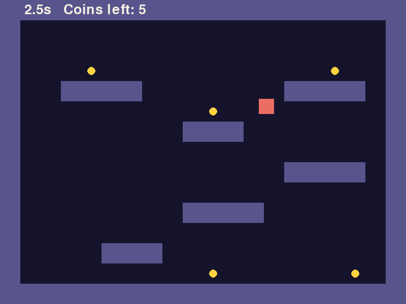
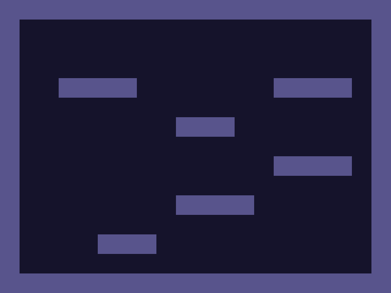
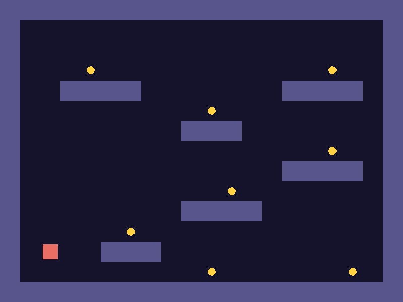
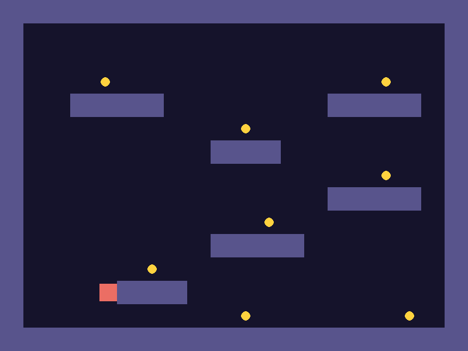
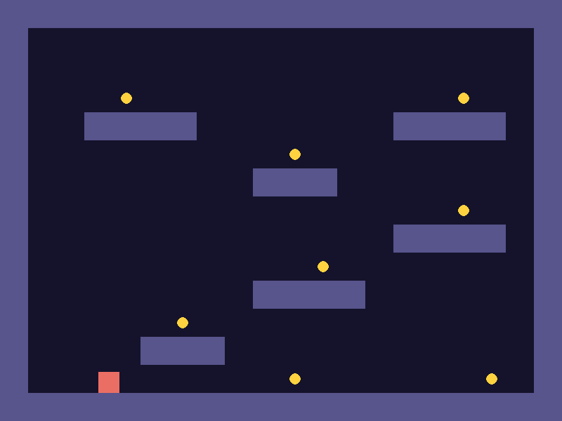
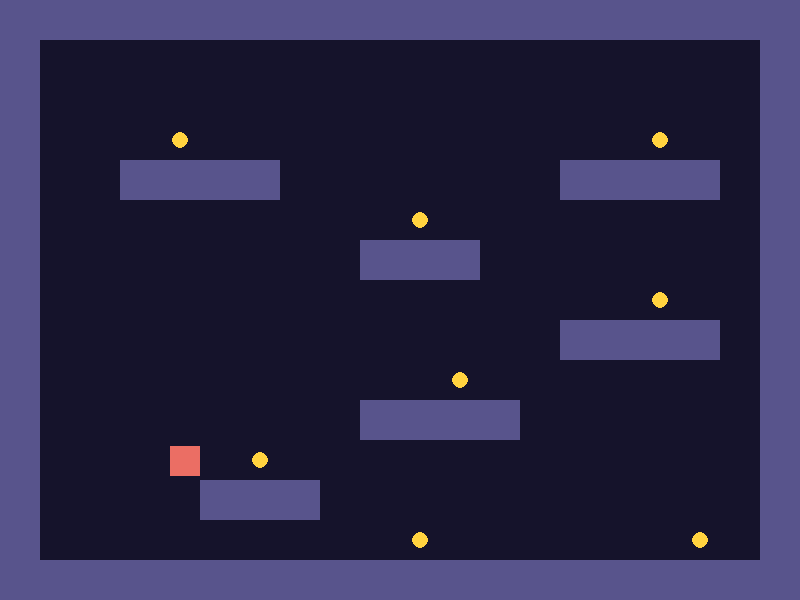
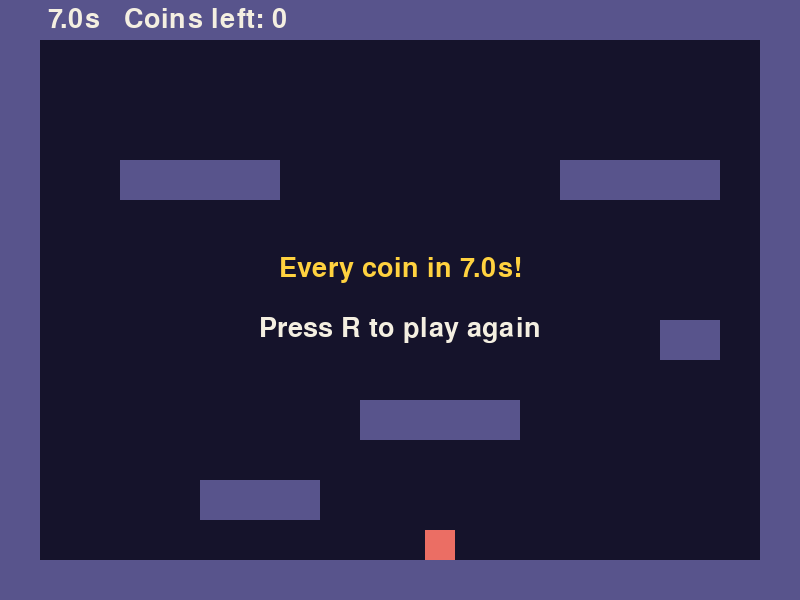

*The finished game. Collect all eight coins as fast as you can.*

Three things are new in this lesson. The level is typed into the code as a picture made of text, and nested loops turn it into rectangles. The player is pulled down by gravity and can jump. And the player has to stop when it runs into a block, from any side, which takes one idea you haven't seen yet: move in one direction at a time.

There is nothing to download. Make a folder called `coin-climb` with an empty `main.py` in it, and open a terminal in that folder.

## 1. Write the level as text

You start from an empty file again, and the first few lines are the same loop you wrote in Rain Dodge. That's deliberate. By now you should be able to type the skeleton (set up, `draw`, `main` with its event loop) without looking.

The new part is `LEVEL`. It's a list of 15 strings, and every string is 20 characters long. Each character stands for one square tile of the screen, 40 pixels on a side: 20 tiles across makes 800 pixels and 15 tiles down makes 600. A `#` is a solid block and a `.` is empty space. The `o` and `P` characters are coins and the player's starting place. The code ignores them until step 2.

Take care typing the level. Every row needs its quotes, its comma, and exactly 20 characters.

```python title="main.py" showLineNumbers file=coin-climb/step1.py
import pygame

pygame.init()
WIDTH, HEIGHT = 800, 600
WIN = pygame.display.set_mode((WIDTH, HEIGHT))
pygame.display.set_caption("Coin Climb")
CLOCK = pygame.time.Clock()

INDIGO = (21, 19, 43)
CREAM = (244, 239, 225)
GOLD = (255, 210, 63)
SLATE = (88, 84, 140)
CORAL = (235, 110, 100)

TILE = 40
LEVEL = [
    "####################",
    "#..................#",
    "#..................#",
    "#...o...........o..#",
    "#..####.......####.#",
    "#.........o........#",
    "#........###.......#",
    "#...............o..#",
    "#.............####.#",
    "#..........o.......#",
    "#........####......#",
    "#.....o............#",
    "#.P..###...........#",
    "#.........o......o.#",
    "####################",
]

def build_level():
    blocks = []
    for row in range(len(LEVEL)):
        for col in range(len(LEVEL[row])):
            tile = LEVEL[row][col]
            x = col * TILE
            y = row * TILE
            if tile == "#":
                blocks.append(pygame.Rect(x, y, TILE, TILE))
    return blocks

def draw(blocks):
    WIN.fill(INDIGO)
    for block in blocks:
        pygame.draw.rect(WIN, SLATE, block)
    pygame.display.update()

def main():
    blocks = build_level()
    while True:
        CLOCK.tick(60)
        for event in pygame.event.get():
            if event.type == pygame.QUIT:
                return
        draw(blocks)

main()
pygame.quit()
```

`build_level` is the nested loop from Brick Buster, one loop for rows and one inside it for columns. In Brick Buster every position in the grid got a brick. Here the loop looks at the text first:

- `LEVEL[row]` is one string, and `LEVEL[row][col]` is one character of it. Line 38 saves that character as `tile`.
- Lines 39 and 40 turn the position in the text into a position on screen. Column 3 is 3 tiles from the left edge, so its x is `3 * TILE`, which is 120.
- Lines 41 and 42 make a `Rect` only where the character is `#`.

The level has no way out. The top row, the bottom row and both ends of every row are blocks, so the player can never leave the screen and you don't need the edge checks you wrote for the ship in Rain Dodge.

:::tip[Checkpoint 1]
Run `py main.py` (Windows) or `python3 main.py` (Mac). You see a dark window with a purple border all the way round and six purple platforms. It should look like your text, with each `#` drawn as a square.



| If this happens | Do this |
| --- | --- |
| `SyntaxError: unterminated string literal` | A row of `LEVEL` is missing its closing `"`. The error names the line. |
| The floor is missing and part of the level sits one row too high | A row of `LEVEL` is missing the comma at its end. Python glues two strings with no comma between them into one long string, so the level ends up a row short. |
| A platform is in the wrong place, or the border has a hole | Count the characters in that row. Each row is 20 long, and a row with too few leaves a gap on the right. |
| The level is drawn on its side, or as one diagonal line of blocks | Line 39 should be `col * TILE` and line 40 `row * TILE`. Check they aren't the wrong way round or both using `row`. |
:::

## 2. Add the coins and the player

The same loop can pick out the other characters. An `o` becomes a small `Rect` for a coin, and a `P` sets where the player starts. The player is a `Rect` too, 30 pixels square, a little smaller than a tile so it fits through gaps one tile wide.

First the size. It goes between `TILE` and `LEVEL`, and it moves everything below it down one line.

```python title="main.py" showLineNumbers startLineNumber=15 ins={2} file=coin-climb/step2.py
TILE = 40
PLAYER_SIZE = 30
LEVEL = [
```

Now `build_level`. A tile is 40 pixels wide and a coin is 16, so adding 12 to x and y puts the coin in the middle of its tile (12 + 16 + 12 = 40). Adding 5 does the same for the 30 pixel player.

```python title="main.py" showLineNumbers startLineNumber=35 ins={3-4,12-16} mark={17} file=coin-climb/step2.py
def build_level():
    blocks = []
    coins = []
    player = pygame.Rect(0, 0, PLAYER_SIZE, PLAYER_SIZE)
    for row in range(len(LEVEL)):
        for col in range(len(LEVEL[row])):
            tile = LEVEL[row][col]
            x = col * TILE
            y = row * TILE
            if tile == "#":
                blocks.append(pygame.Rect(x, y, TILE, TILE))
            if tile == "o":
                coins.append(pygame.Rect(x + 12, y + 12, 16, 16))
            if tile == "P":
                player.x = x + 5
                player.y = y + 5
    return blocks, coins, player
```

Line 51 returns three things at once, separated by commas. Whoever calls the function catches them with three names, in the same order. It's the same idea as `WIDTH, HEIGHT = 800, 600` at the top of the file.

Draw the new things, and catch the three values in `main`. Coins are drawn as circles, as in Pop. A `Rect` knows its own middle, `coin.center`, which is what `pygame.draw.circle` wants.

```python title="main.py" showLineNumbers startLineNumber=53 mark={1,11,17} ins={5-7} file=coin-climb/step2.py
def draw(blocks, coins, player):
    WIN.fill(INDIGO)
    for block in blocks:
        pygame.draw.rect(WIN, SLATE, block)
    for coin in coins:
        pygame.draw.circle(WIN, GOLD, coin.center, 8)
    pygame.draw.rect(WIN, CORAL, player)
    pygame.display.update()

def main():
    blocks, coins, player = build_level()
    while True:
        CLOCK.tick(60)
        for event in pygame.event.get():
            if event.type == pygame.QUIT:
                return
        draw(blocks, coins, player)
```

:::tip[Checkpoint 2]
Run it. Eight gold coins appear, six above the platforms and two near the floor. A coral square hangs in the air near the bottom left corner. Nothing moves yet.



| If this happens | Do this |
| --- | --- |
| `ValueError: too many values to unpack (expected 3)` | Line 51 still says `return blocks`. It has to return all three: `return blocks, coins, player`. |
| `TypeError: draw() missing 2 required positional arguments: 'coins' and 'player'` | Line 53 has the new names but the call on line 69 doesn't. Both need all three. |
| The player is stuck in the top left corner, inside a block | Lines 48 to 50 are missing, or the `P` in your level is a lowercase `p`. |
| Fewer than eight coins | Compare your `LEVEL` with step 1. The coins are lowercase letter `o`, not zeros. |
:::

## 3. Run, and stop at walls

Moving left and right uses held keys, as the ship did in Rain Dodge. The difference is what stops you. The ship only had to stay inside the window. This player has to stop at any block, anywhere in the level.

The way to do that is to move first and fix it afterwards:

1. Move the player by `dx`, even if that puts it inside a block.
2. Look through the blocks. `player.colliderect(block)` is `True` when the two rectangles overlap.
3. If it overlaps one, push the player back out. If it was moving right, it must have gone in through the block's left side, so set the player's right edge to the block's left edge. If it was moving left, do the opposite.

All of this happens before anything is drawn, so you never see the player inside the block.

Add the speed under `PLAYER_SIZE`.

```python title="main.py" showLineNumbers startLineNumber=15 ins={3} file=coin-climb/step3.py
TILE = 40
PLAYER_SIZE = 30
SPEED = 5
LEVEL = [
```

Then the new function, between `build_level` and `draw`.

```python title="main.py" showLineNumbers startLineNumber=54 ins={1-14} file=coin-climb/step3.py
def move_x(player, blocks):
    keys = pygame.key.get_pressed()
    dx = 0
    if keys[pygame.K_LEFT]:
        dx = -SPEED
    if keys[pygame.K_RIGHT]:
        dx = SPEED
    player.x += dx
    for block in blocks:
        if player.colliderect(block):
            if dx > 0:
                player.right = block.left
            if dx < 0:
                player.left = block.right
```

`dx` is the same idea as the ball's `dx` in Brick Buster: how far to move sideways this frame. Here it is worked out fresh every frame from the keys. Lines 65 and 67 use something new about a `Rect`: you can set `right`, `left`, `top` or `bottom`, and the whole rectangle moves so that edge is where you said.

Call it from the loop.

```python title="main.py" showLineNumbers startLineNumber=78 ins={8} file=coin-climb/step3.py
def main():
    blocks, coins, player = build_level()
    while True:
        CLOCK.tick(60)
        for event in pygame.event.get():
            if event.type == pygame.QUIT:
                return
        move_x(player, blocks)
        draw(blocks, coins, player)
```

:::tip[Checkpoint 3]
Run it. The arrow keys slide the square left and right. It is still floating, and it passes over the coins without collecting them. Going left it stops at the border. Going right it stops against the side of the lowest platform.



| If this happens | Do this |
| --- | --- |
| The square doesn't move | Click the game window first. Then check that `move_x(player, blocks)` on line 85 is inside the `while` loop, lined up with `draw`. |
| `TypeError: move_x() missing 1 required positional argument: 'blocks'` | The call on line 85 needs both values: `move_x(player, blocks)`. |
| The square jumps to the far side of the platform when it touches it | Lines 65 and 67 are swapped. Moving right (`dx > 0`) sets `player.right`. Moving left sets `player.left`. |
| The square goes straight through blocks | Check lines 62 to 67 are indented inside `move_x`, and that line 63 says `colliderect`. |
:::

## 4. Gravity

In Brick Buster the ball had a `dy` that stayed the same until it bounced. Gravity is a `dy` that keeps changing. The player has a vertical speed called `vy`, and every frame it grows by 1. Remember that y grows downward, so a bigger `vy` means falling faster.

| Frame | `vy` | Fallen so far |
| --- | --- | --- |
| 1 | 1 | 1 pixel |
| 2 | 2 | 3 pixels |
| 3 | 3 | 6 pixels |
| 10 | 10 | 55 pixels |

That slow start and fast finish is what makes a fall look like a fall.

Landing uses the same move-then-fix method as walls, with one rule added: **move sideways and fix, then move down and fix, and never both together.**


Suppose you moved the player across and down in one go and then found it overlapping a block. Should it be pushed up, or sideways? The code can't tell. If it always pushes up, a player who runs into a wall is lifted onto the top of it. If it always pushes sideways, a player running along the floor is shoved to the end of the floor block it sank into, so it snags or shoots backwards.

Doing one direction at a time removes the question. After a sideways move, any overlap must have come from moving sideways, so `move_x` pushes sideways. After a vertical move, any overlap must have come from moving up or down, so the new function `move_y` pushes up or down.

Two new settings go under `SPEED`.

```python title="main.py" showLineNumbers startLineNumber=15 ins={4-5} file=coin-climb/step4.py
TILE = 40
PLAYER_SIZE = 30
SPEED = 5
GRAVITY = 1
MAX_FALL = 20
LEVEL = [
```

Add `move_y` below `move_x`.

```python title="main.py" showLineNumbers startLineNumber=71 ins={1-10} file=coin-climb/step4.py
def move_y(player, blocks, vy):
    vy += GRAVITY
    if vy > MAX_FALL:
        vy = MAX_FALL
    player.y += vy
    for block in blocks:
        if player.colliderect(block):
            player.bottom = block.top
            vy = 0
    return vy
```

Lines 73 and 74 cap the falling speed. A block is 40 pixels tall. If the player ever moved more than that in one frame, it could be above a block on one frame and below it on the next without overlapping it in between, and it would fall through. Capping the speed at 20 means that can't happen.

Line 79 is the landing: the fall is over, so the speed goes back to 0.

Line 80 is there because `vy` is a number. When a function changes a `Rect` you passed in, the change shows up outside the function, which is why `move_x` never had to return `player`. A number doesn't work that way. The `vy` inside `move_y` is a copy, so the function hands the new value back and `main` saves it.

```python title="main.py" showLineNumbers startLineNumber=91 ins={3,10} file=coin-climb/step4.py
def main():
    blocks, coins, player = build_level()
    vy = 0
    while True:
        CLOCK.tick(60)
        for event in pygame.event.get():
            if event.type == pygame.QUIT:
                return
        move_x(player, blocks)
        vy = move_y(player, blocks, vy)
        draw(blocks, coins, player)
```

:::tip[Checkpoint 4]
Run it. The square drops a short way to the floor and stops. You can run along the floor, and you still stop at the border walls and at the side of the lowest platform. There's no way up yet.



| If this happens | Do this |
| --- | --- |
| `TypeError: unsupported operand type(s) for +=: 'NoneType' and 'int'` | Line 80, `return vy`, is missing. Without it the function gives back `None`. |
| `UnboundLocalError: cannot access local variable 'vy' where it is not associated with a value` | Line 93, `vy = 0`, is missing. |
| The square sinks slowly at a steady speed instead of speeding up | Line 100 has to save the answer: `vy = move_y(player, blocks, vy)`. Also check line 93 is above `while True:` and not inside the loop. |
| The square falls through the floor and disappears | Check lines 76 to 79. The `for` loop has to come after `player.y += vy`, and line 78 sets `player.bottom`. |
:::

## 5. Jump

A jump is one line: set `vy` to a negative number. Negative means up. Gravity then does the rest. It adds 1 every frame, so the player rises more and more slowly, stops for an instant at the top, and falls. You don't write any code for the arc.

With `JUMP = -15` the player climbs 14 pixels on the first frame, then 13, then 12, down to 1. That adds up to 105 pixels, a little over two and a half tiles. So a platform two tiles above you can be reached and one three tiles above you can't. Keep that in mind when you design your own levels.

A jump should only start when the player is standing on something. Otherwise holding the key would fly you to the ceiling. So `move_y` keeps a second piece of information, `on_ground`. It starts each frame as `False` and becomes `True` only if the player landed on a block during that frame.

That works even when the player seems to be standing still. Gravity pushes it 1 pixel into the floor every frame, the loop pushes it back out, and that counts as a landing. Walk off a ledge and there's nothing to land on, so `on_ground` is `False` until you hit something.

Now that the player can move upward, it can also hit a block from below. That's the mirror image of landing: put the player's top at the block's bottom. The speed is set to 0 in both cases, so after bumping its head the player starts falling right away.

Add the jump strength under `MAX_FALL`.

```python title="main.py" showLineNumbers startLineNumber=15 ins={6} file=coin-climb/step5.py
TILE = 40
PLAYER_SIZE = 30
SPEED = 5
GRAVITY = 1
MAX_FALL = 20
JUMP = -15
LEVEL = [
```

Change `move_y`. Line 81 is your old landing line, moved one level deeper so it only runs when the player was falling.

```python title="main.py" showLineNumbers startLineNumber=72 ins={6,9,11-13} mark={10,15} file=coin-climb/step5.py
def move_y(player, blocks, vy):
    vy += GRAVITY
    if vy > MAX_FALL:
        vy = MAX_FALL
    player.y += vy
    on_ground = False
    for block in blocks:
        if player.colliderect(block):
            if vy > 0:
                player.bottom = block.top
                on_ground = True
            if vy < 0:
                player.top = block.bottom
            vy = 0
    return vy, on_ground
```

Then `main`. The function now returns two things, so line 110 catches two.

```python title="main.py" showLineNumbers startLineNumber=97 ins={4,10-12} mark={14} file=coin-climb/step5.py
def main():
    blocks, coins, player = build_level()
    vy = 0
    on_ground = False
    while True:
        CLOCK.tick(60)
        for event in pygame.event.get():
            if event.type == pygame.QUIT:
                return
        keys = pygame.key.get_pressed()
        if (keys[pygame.K_SPACE] or keys[pygame.K_UP]) and on_ground:
            vy = JUMP
        move_x(player, blocks)
        vy, on_ground = move_y(player, blocks, vy)
        draw(blocks, coins, player)
```

The brackets on line 107 matter. It reads "space or up, and also on the ground". Without them Python would read it as "space, or else up while on the ground", and space would work in mid-air.

:::tip[Checkpoint 5]
Run it. Space or the up arrow jumps. Hold right and jump to get onto the lowest platform, then keep climbing. You can reach every platform. If you jump underneath a platform you bump your head and drop. Walking off an edge makes you fall, and you can't jump again until you land.



| If this happens | Do this |
| --- | --- |
| `TypeError: cannot unpack non-iterable int object` | Line 86 still says `return vy`. It needs both: `return vy, on_ground`. |
| `TypeError: can only concatenate tuple (not "int") to tuple` | Line 110 still says `vy = move_y(...)`. It needs two names: `vy, on_ground = move_y(player, blocks, vy)`. |
| The game crashes with `UnboundLocalError` the first time you press space | Line 100, `on_ground = False`, is missing. |
| Nothing happens when you press space | Check line 82, `on_ground = True`, is indented under `if vy > 0:`. Then check line 77 is above the `for` loop and not inside it. |
| Holding space flies you up to the ceiling | Line 107 is missing `and on_ground`, or is missing its brackets. |
| The square hangs under a platform for a moment after bumping its head | Line 85, `vy = 0`, is missing or is indented under `if vy > 0:`. It should line up with the two `if vy` lines, so that it runs for both of them. |
:::

## 6. Collect the coins and win

Collecting is the smallest part of the game. Each frame, look through the coins, and remove any the player is touching. You loop over the copy `coins[:]` and remove from the original, for the same reason as the raindrops in Rain Dodge.

Winning is one test: the list of coins is empty.

The score is the time it took, and here tenths of a second matter. In Rain Dodge you divided the milliseconds with `//` to get whole seconds. This time use `/`, which keeps the fraction, and write `{seconds:.1f}` inside the f-string. The `:.1f` means "show one digit after the decimal point".

The win screen is the game-over screen from Extend Rain Dodge with different words. It waits for R or for the window to close, and returns `True` or `False`. As before, `main` passes that answer on and the last lines of the file run `main` again for as long as the answer is `True`.

Text needs a font. Add it under `CLOCK`. Everything below moves down one line.

```python title="main.py" showLineNumbers startLineNumber=5 ins={4} file=coin-climb/step6.py
WIN = pygame.display.set_mode((WIDTH, HEIGHT))
pygame.display.set_caption("Coin Climb")
CLOCK = pygame.time.Clock()
FONT = pygame.font.Font(None, 40)
```

Two new functions go below `move_y`.

```python title="main.py" showLineNumbers startLineNumber=89 ins={1-19} file=coin-climb/step6.py
def collect(player, coins):
    for coin in coins[:]:
        if player.colliderect(coin):
            coins.remove(coin)

def win_screen(seconds):
    pygame.draw.rect(WIN, INDIGO, (140, 220, 520, 160))
    text = FONT.render(f"Every coin in {seconds:.1f}s!", True, GOLD)
    WIN.blit(text, (WIDTH // 2 - text.get_width() // 2, 255))
    hint = FONT.render("Press R to play again", True, CREAM)
    WIN.blit(hint, (WIDTH // 2 - hint.get_width() // 2, 315))
    pygame.display.update()
    while True:
        CLOCK.tick(60)
        for event in pygame.event.get():
            if event.type == pygame.QUIT:
                return False
            if event.type == pygame.KEYDOWN and event.key == pygame.K_r:
                return True
```

Line 95 paints a dark rectangle over the middle of the level so the words are easy to read.

Show the time and the number of coins left. They are drawn on top of the row of blocks along the top, which makes a ready-made status bar.

```python title="main.py" showLineNumbers startLineNumber=109 mark={1} ins={8-9} file=coin-climb/step6.py
def draw(blocks, coins, player, seconds):
    WIN.fill(INDIGO)
    for block in blocks:
        pygame.draw.rect(WIN, SLATE, block)
    for coin in coins:
        pygame.draw.circle(WIN, GOLD, coin.center, 8)
    pygame.draw.rect(WIN, CORAL, player)
    label = f"{seconds:.1f}s   Coins left: {len(coins)}"
    WIN.blit(FONT.render(label, True, CREAM), (48, 6))
    pygame.display.update()
```

Last, `main` and the end of the file. The `return` on line 129 becomes `return False`, and the single `main()` call at the bottom becomes the two-line loop.

```python title="main.py" showLineNumbers startLineNumber=120 ins={5,11,17,19-20,23} mark={10,18,22} file=coin-climb/step6.py
def main():
    blocks, coins, player = build_level()
    vy = 0
    on_ground = False
    start = pygame.time.get_ticks()
    while True:
        CLOCK.tick(60)
        for event in pygame.event.get():
            if event.type == pygame.QUIT:
                return False
        seconds = (pygame.time.get_ticks() - start) / 1000
        keys = pygame.key.get_pressed()
        if (keys[pygame.K_SPACE] or keys[pygame.K_UP]) and on_ground:
            vy = JUMP
        move_x(player, blocks)
        vy, on_ground = move_y(player, blocks, vy)
        collect(player, coins)
        draw(blocks, coins, player, seconds)
        if len(coins) == 0:
            return win_screen(seconds)

while main():
    pass
pygame.quit()
```

The win test on line 138 comes after `draw` on purpose. The last coin has already been removed and the screen redrawn without it before the message goes on top.

Pressing R calls `main` again, and `main` starts by calling `build_level`, which reads `LEVEL` and makes brand new lists. That's how the coins come back.

:::tip[Checkpoint 6]
Run it and play. The bar at the top shows the time and "Coins left: 8". Each coin you touch disappears and the count drops. When the last one goes, a gold message shows your time. R starts again from 0.0 with all eight coins back. Closing the window quits, both mid-game and on the win screen.



| If this happens | Do this |
| --- | --- |
| `NameError: name 'FONT' is not defined` | Line 8 is missing. |
| `TypeError: draw() takes 3 positional arguments but 4 were given` | Line 109 needs the fourth name, `seconds`, to match the call on line 137. |
| `NameError: name 'seconds' is not defined` | Line 130 is missing, or it comes after line 137. |
| R does nothing on the win screen | Line 139 should be `return win_screen(seconds)`. Without `return` the loop carries on with no coins left and shows the win screen again straight away. |
| The time shows a long string of digits | Check for `:.1f` after `seconds` on lines 96 and 116. |
:::

## The finished code

If something still doesn't work, compare your file with this one.

<details>
<summary>All 143 lines of main.py</summary>

```python title="main.py" showLineNumbers file=coin-climb/step6.py
import pygame

pygame.init()
WIDTH, HEIGHT = 800, 600
WIN = pygame.display.set_mode((WIDTH, HEIGHT))
pygame.display.set_caption("Coin Climb")
CLOCK = pygame.time.Clock()
FONT = pygame.font.Font(None, 40)

INDIGO = (21, 19, 43)
CREAM = (244, 239, 225)
GOLD = (255, 210, 63)
SLATE = (88, 84, 140)
CORAL = (235, 110, 100)

TILE = 40
PLAYER_SIZE = 30
SPEED = 5
GRAVITY = 1
MAX_FALL = 20
JUMP = -15
LEVEL = [
    "####################",
    "#..................#",
    "#..................#",
    "#...o...........o..#",
    "#..####.......####.#",
    "#.........o........#",
    "#........###.......#",
    "#...............o..#",
    "#.............####.#",
    "#..........o.......#",
    "#........####......#",
    "#.....o............#",
    "#.P..###...........#",
    "#.........o......o.#",
    "####################",
]

def build_level():
    blocks = []
    coins = []
    player = pygame.Rect(0, 0, PLAYER_SIZE, PLAYER_SIZE)
    for row in range(len(LEVEL)):
        for col in range(len(LEVEL[row])):
            tile = LEVEL[row][col]
            x = col * TILE
            y = row * TILE
            if tile == "#":
                blocks.append(pygame.Rect(x, y, TILE, TILE))
            if tile == "o":
                coins.append(pygame.Rect(x + 12, y + 12, 16, 16))
            if tile == "P":
                player.x = x + 5
                player.y = y + 5
    return blocks, coins, player

def move_x(player, blocks):
    keys = pygame.key.get_pressed()
    dx = 0
    if keys[pygame.K_LEFT]:
        dx = -SPEED
    if keys[pygame.K_RIGHT]:
        dx = SPEED
    player.x += dx
    for block in blocks:
        if player.colliderect(block):
            if dx > 0:
                player.right = block.left
            if dx < 0:
                player.left = block.right

def move_y(player, blocks, vy):
    vy += GRAVITY
    if vy > MAX_FALL:
        vy = MAX_FALL
    player.y += vy
    on_ground = False
    for block in blocks:
        if player.colliderect(block):
            if vy > 0:
                player.bottom = block.top
                on_ground = True
            if vy < 0:
                player.top = block.bottom
            vy = 0
    return vy, on_ground

def collect(player, coins):
    for coin in coins[:]:
        if player.colliderect(coin):
            coins.remove(coin)

def win_screen(seconds):
    pygame.draw.rect(WIN, INDIGO, (140, 220, 520, 160))
    text = FONT.render(f"Every coin in {seconds:.1f}s!", True, GOLD)
    WIN.blit(text, (WIDTH // 2 - text.get_width() // 2, 255))
    hint = FONT.render("Press R to play again", True, CREAM)
    WIN.blit(hint, (WIDTH // 2 - hint.get_width() // 2, 315))
    pygame.display.update()
    while True:
        CLOCK.tick(60)
        for event in pygame.event.get():
            if event.type == pygame.QUIT:
                return False
            if event.type == pygame.KEYDOWN and event.key == pygame.K_r:
                return True

def draw(blocks, coins, player, seconds):
    WIN.fill(INDIGO)
    for block in blocks:
        pygame.draw.rect(WIN, SLATE, block)
    for coin in coins:
        pygame.draw.circle(WIN, GOLD, coin.center, 8)
    pygame.draw.rect(WIN, CORAL, player)
    label = f"{seconds:.1f}s   Coins left: {len(coins)}"
    WIN.blit(FONT.render(label, True, CREAM), (48, 6))
    pygame.display.update()

def main():
    blocks, coins, player = build_level()
    vy = 0
    on_ground = False
    start = pygame.time.get_ticks()
    while True:
        CLOCK.tick(60)
        for event in pygame.event.get():
            if event.type == pygame.QUIT:
                return False
        seconds = (pygame.time.get_ticks() - start) / 1000
        keys = pygame.key.get_pressed()
        if (keys[pygame.K_SPACE] or keys[pygame.K_UP]) and on_ground:
            vy = JUMP
        move_x(player, blocks)
        vy, on_ground = move_y(player, blocks, vy)
        collect(player, coins)
        draw(blocks, coins, player, seconds)
        if len(coins) == 0:
            return win_screen(seconds)

while main():
    pass
pygame.quit()
```

</details>

## More to try

Roughly easiest first.

- **Your own level.** Change the strings in `LEVEL`. Keep the border, keep one `P`, and remember the jump reaches two tiles up and not three. Swap files with someone and race on each other's levels.
- **A best time that saves.** Use `load_best` and `save_best` from Extend Rain Dodge to keep the fastest time in a file and show it on the win screen. This time lower is better, and a missing file means there is no best yet.
- **A coin sound.** Play a short sound in `collect` each time a coin is removed, with `pygame.mixer.Sound` as in Pop.
- **A second level.** Make `LEVELS`, a list that holds two of these lists of strings, and give `build_level` a number saying which one to read. When the coins run out on the first level, build the second and keep the clock running. Show the win screen only after the last one.
- **A scrolling camera.** A level can be wider than the window if you let rows be longer than 20 characters. Keep every `Rect` where it really is in the level, and work out a `camera_x` each frame from the player's x so the player stays near the middle. In `draw`, subtract `camera_x` from the x of everything you draw. Nothing in the movement code has to change.
