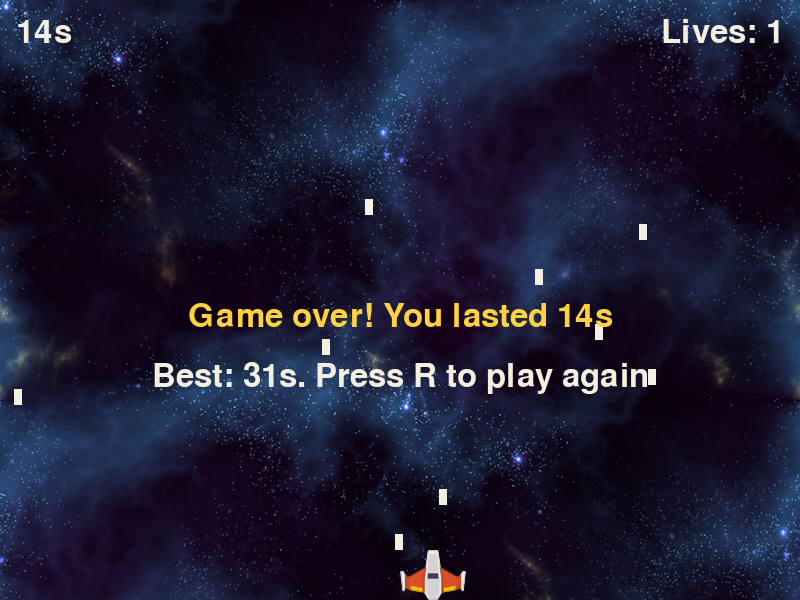
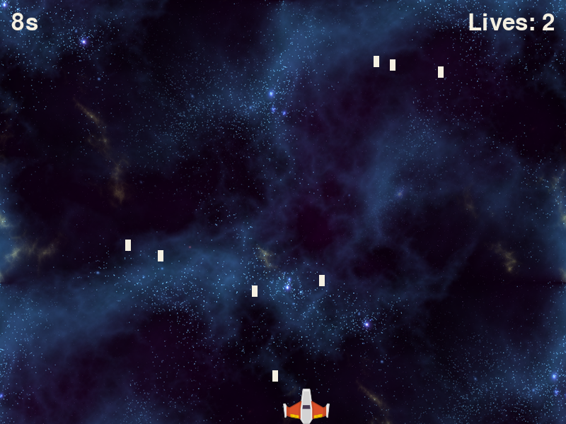

*Where you'll end up: a lives counter, a best time, and a way to play again.*

Start from your finished `main.py` from Rain Dodge. If yours doesn't run, copy [the finished code](../rain-dodge/#the-finished-code) into it first.

As before, **lines marked + are new and lines marked ~ have changed**. This time you'll also delete a few lines. The text tells you when.

## 1. Three lives

Right now one drop ends the game. To survive a hit, the game has to remove the drop that touched the ship, take away a life, and only end when no lives are left.

In Rain Dodge you only asked `collidelist` whether there was a hit. It also tells you which drop it was: its answer is that drop's position in the list. Save the answer in a variable and you can remove exactly that drop with `drops.pop(hit)`.

Start with `draw`, so there's somewhere to show the count. It goes in the top right corner.

```python title="main.py" showLineNumbers startLineNumber=44 mark={1} ins={7-8} file=extend-rain-dodge/step1.py
def draw(player, drops, score, lives):
    WIN.blit(BG, (0, 0))
    WIN.blit(SHIP, player)
    for drop in drops:
        pygame.draw.rect(WIN, CREAM, drop)
    WIN.blit(FONT.render(f"{score}s", True, CREAM), (16, 16))
    text = FONT.render(f"Lives: {lives}", True, CREAM)
    WIN.blit(text, (WIDTH - text.get_width() - 16, 16))
    pygame.display.update()
```

The score sits 16 pixels from the left edge. To put the lives 16 pixels from the right edge you need to know how wide the text is, which is why line 50 saves it in a variable before line 51 draws it.

Now the loop. The two lines you just added to `draw` have moved `main` down, so it starts on line 54.

```python title="main.py" showLineNumbers startLineNumber=54 ins={4,18-20} mark={16-17,21-23} file=extend-rain-dodge/step1.py
def main():
    player = pygame.Rect(WIDTH // 2, HEIGHT - PLAYER_H, PLAYER_W, PLAYER_H)
    drops = []
    lives = 3
    start = pygame.time.get_ticks()
    while True:
        CLOCK.tick(60)
        for event in pygame.event.get():
            if event.type == pygame.QUIT:
                return
        score = (pygame.time.get_ticks() - start) // 1000
        move_player(player)
        if random.randint(0, 100) < 3 + score // 2:
            spawn_drop(drops)
        move_drops(drops)
        hit = player.collidelist(drops)
        if hit != -1:
            drops.pop(hit)
            lives -= 1
            if lives == 0:
                game_over(score)
                return
        draw(player, drops, score, lives)
```

Lines 74 and 75 are the same two lines you had before, moved one level deeper so they only run when the last life is gone.

Why remove the drop? If you left it, it would still be overlapping the ship on the next frame, and the frame after that. You'd lose all three lives in a twentieth of a second.

:::tip[Checkpoint 1]
Run it and let the rain hit you. The counter in the corner goes from 3 to 2 to 1, each drop that hits you disappears, and the third hit ends the game.



| If this happens | Do this |
| --- | --- |
| `TypeError: draw() ...` | Lines 44 and 76 both need the fourth value, `lives`. |
| All three lives vanish at once | Line 71, `drops.pop(hit)`, is missing. |
| The game never ends | Check line 73 is `if lives == 0:` and that lines 74 and 75 are indented under it. Also check that line 57, `lives = 3`, comes before `while True:`. Inside the loop it resets your lives every frame. |
| `UnboundLocalError` mentioning `lives` | Line 57, `lives = 3`, is missing. |
:::

## 2. Press R to play again

At the moment the game-over message shows for three seconds and the program quits. Instead, the message should stay up until the player presses R to play again or closes the window.

That takes a second, smaller loop inside `game_over`. It draws nothing new. It only waits for one of those two events, and it reports back which one happened: `True` for "play again", `False` for "quit".

**Delete** the `pygame.time.delay(3000)` line at the end of `game_over`, then add the new lines.

```python title="main.py" showLineNumbers startLineNumber=38 ins={4-5,7-13} file=extend-rain-dodge/step2.py
def game_over(score):
    text = FONT.render(f"Game over! You lasted {score}s", True, GOLD)
    WIN.blit(text, (WIDTH // 2 - text.get_width() // 2, HEIGHT // 2))
    hint = FONT.render("Press R to play again", True, CREAM)
    WIN.blit(hint, (WIDTH // 2 - hint.get_width() // 2, HEIGHT // 2 + 60))
    pygame.display.update()
    while True:
        CLOCK.tick(60)
        for event in pygame.event.get():
            if event.type == pygame.QUIT:
                return False
            if event.type == pygame.KEYDOWN and event.key == pygame.K_r:
                return True
```

`main` has to pass that answer along. It now returns `False` when the window is closed mid-game, and whatever `game_over` said when the lives run out. Two lines change, and the old `return` under `game_over(score)` is **deleted** because line 82 now does both jobs.

```python title="main.py" showLineNumbers startLineNumber=62 mark={10,21} file=extend-rain-dodge/step2.py
def main():
    player = pygame.Rect(WIDTH // 2, HEIGHT - PLAYER_H, PLAYER_W, PLAYER_H)
    drops = []
    lives = 3
    start = pygame.time.get_ticks()
    while True:
        CLOCK.tick(60)
        for event in pygame.event.get():
            if event.type == pygame.QUIT:
                return False
        score = (pygame.time.get_ticks() - start) // 1000
        move_player(player)
        if random.randint(0, 100) < 3 + score // 2:
            spawn_drop(drops)
        move_drops(drops)
        hit = player.collidelist(drops)
        if hit != -1:
            drops.pop(hit)
            lives -= 1
            if lives == 0:
                return game_over(score)
        draw(player, drops, score, lives)
```

Finally, the bottom of the file. `main()` used to run once. Now it runs again for as long as it keeps answering `True`.

```python title="main.py" showLineNumbers startLineNumber=85 mark={1} ins={2} file=extend-rain-dodge/step2.py
while main():
    pass
pygame.quit()
```

Every call to `main()` starts with a fresh player, an empty list of drops, three lives and a new start time, because all of those are set at the top of the function. Restarting needs no other code.

:::tip[Checkpoint 2]
Run it and lose. The message stays on screen with "Press R to play again" under it. R starts a new game from 0 seconds with 3 lives. Closing the window quits, both mid-game and on the game-over screen.

| If this happens | Do this |
| --- | --- |
| The window closes by itself after a hit | Line 82 should be `return game_over(score)`. A bare `return` gives back `None`, which the loop on line 85 treats as "stop". |
| R does nothing | Click the game window first. Then check line 49 uses `pygame.K_r` with a lowercase r. |
| The window freezes and says "Not Responding" | The `for event` loop on line 46 is missing from `game_over`. A pygame window has to keep reading events or the system assumes it has crashed. |
| The game freezes when you lose and no message appears | `pygame.display.update()` on line 43 is missing, or it comes after the `while True:` loop starts. |
:::

## 3. A high score that saves

Variables disappear when the program closes. To remember the best time between runs, the game has to write it to a file and read it back next time.

The file is called `best.txt` and holds one number. Two small functions handle it. The first time you play there's no file yet, so `load_best` checks for it and answers 0 if it isn't there.

That check needs the `os` module. Add the import at the very top of the file. Every line number below it moves down by one.

```python title="main.py" showLineNumbers ins={1} file=extend-rain-dodge/step3.py
import os
import random
import pygame
```

Add the two functions below `move_drops`.

```python title="main.py" showLineNumbers startLineNumber=39 ins={1-5,7-9} file=extend-rain-dodge/step3.py
def load_best():
    if os.path.exists("best.txt"):
        with open("best.txt") as file:
            return int(file.read())
    return 0

def save_best(score):
    with open("best.txt", "w") as file:
        file.write(str(score))
```

`with open(...) as file:` opens the file, lets the indented lines use it, and closes it for you afterwards. A file holds text, not numbers, so `int(...)` turns the text back into a number when reading and `str(...)` turns the number into text when writing. Opening with `"w"` replaces whatever was in the file before.

Use them in `game_over`.

```python title="main.py" showLineNumbers startLineNumber=49 ins={2-5} mark={8} file=extend-rain-dodge/step3.py
def game_over(score):
    best = load_best()
    if score > best:
        best = score
        save_best(best)
    text = FONT.render(f"Game over! You lasted {score}s", True, GOLD)
    WIN.blit(text, (WIDTH // 2 - text.get_width() // 2, HEIGHT // 2))
    hint = FONT.render(f"Best: {best}s. Press R to play again", True, CREAM)
    WIN.blit(hint, (WIDTH // 2 - hint.get_width() // 2, HEIGHT // 2 + 60))
```

:::tip[Checkpoint 3]
Run it and lose. The second line now starts with your best time. Close the game completely, run it again and lose quickly: the best time from the earlier run is still there. As long as you lasted at least one second, a file called `best.txt` has appeared next to `main.py`. Open it and you'll see the number.

| If this happens | Do this |
| --- | --- |
| `NameError: name 'os' is not defined` | Line 1, `import os`, is missing. |
| The best time is always the same as your score | Line 51 should compare with `>`, and lines 52 and 53 should be indented under it. |
| `ValueError: invalid literal for int()` | `best.txt` has something in it that isn't a number, probably from editing it by hand. Delete the file and the game will make a new one. |
| The best time resets every run | Check the file name is spelled the same way on lines 40, 41 and 46. |
:::

## One thing that's still wrong

Look at the game-over screenshot at the top of this page. The corner says "Lives: 1", but the game ended because you had none left.

That isn't a mistake in your typing. The loop takes away the last life and jumps straight to `game_over` without calling `draw` again, so the screen still shows the frame from before the final hit. Can you fix it? There's more than one way.

## More to try

- Show the best time in a corner while you play, not only at the end.
- Flash the ship or the background for a moment when you lose a life.
- Give back a life every 30 seconds survived.
