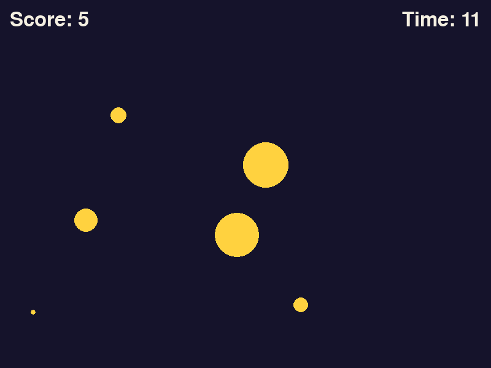
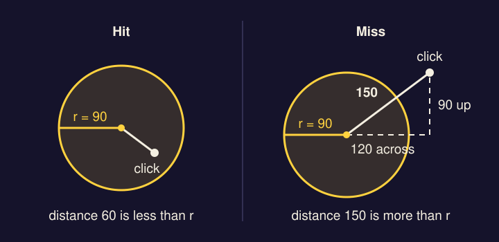
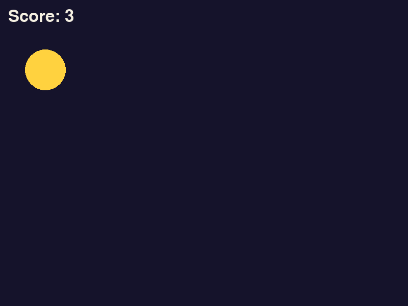
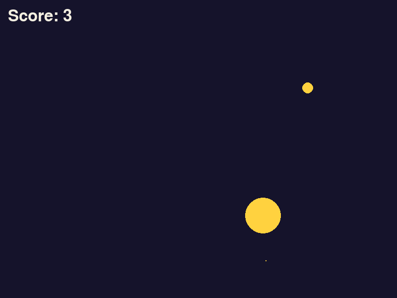
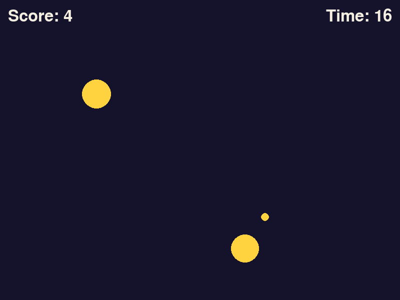
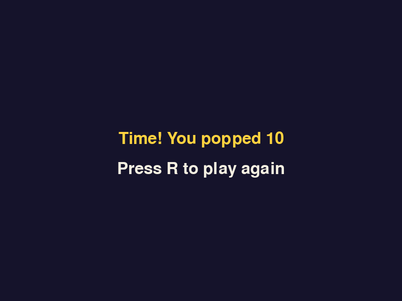

*The finished game. Click the targets before they shrink away.*

Rain Dodge was played with the keyboard and made of rectangles. Pop is played with the mouse and made of circles, and that changes three things: how you read input, how you decide what was hit, and how you store the things on screen. You'll also run a timer backwards and play sounds.

You start from an empty file and type the game loop again. That's deliberate. By now you should be able to write it from memory, so try before you look.

## Get the files

Make a folder called `pop` and save both sounds into it.

- <a href="../downloads/pop/pop.wav" download>Download pop.wav</a> (a click that hits)
- <a href="../downloads/pop/miss.wav" download>Download miss.wav</a> (a click that misses)

Then make an empty file called `main.py` in the same folder, and open a terminal there. You won't need the sounds until step 5.

## 1. Draw a circle

The loop is the one from Rain Dodge: events, update, draw. Two things in `draw` are new.

There's no background picture this time, so `WIN.fill(INDIGO)` paints the whole window one color. It does the same job the background `blit` did: it wipes out the last frame so you can draw the new one.

`pygame.draw.circle` takes the window, a color, the **center** of the circle as a pair of numbers in brackets, and the radius (the distance from the center to the edge). That's different from a `Rect`, whose position is its top left corner.

```python title="main.py" showLineNumbers file=pop/step1.py
import math
import random
import pygame

pygame.init()
WIDTH, HEIGHT = 800, 600
WIN = pygame.display.set_mode((WIDTH, HEIGHT))
pygame.display.set_caption("Pop")
CLOCK = pygame.time.Clock()

INDIGO = (21, 19, 43)
GOLD = (255, 210, 63)
CREAM = (244, 239, 225)

START_R = 40

def draw():
    WIN.fill(INDIGO)
    pygame.draw.circle(WIN, GOLD, (WIDTH // 2, HEIGHT // 2), START_R)
    pygame.display.update()

def main():
    while True:
        CLOCK.tick(60)
        for event in pygame.event.get():
            if event.type == pygame.QUIT:
                return
        draw()

main()
pygame.quit()
```

`START_R` is the radius every target starts with. `math`, `random` and `CREAM` aren't used yet. They're there now so the line numbers stay put later.

:::tip[Checkpoint 1]
Run `py main.py` (Windows) or `python3 main.py` (Mac). A dark window opens with one gold circle in the middle.


| If this happens | Do this |
| --- | --- |
| `TypeError: center argument must be a pair of numbers` | The center on line 19 needs its own brackets: `(WIDTH // 2, HEIGHT // 2)`. |
| `AttributeError: module 'pygame.draw' has no attribute 'circel'. Did you mean: 'circle'?` | A name is misspelled or has the wrong capitals. Python tells you the line and usually guesses the right name. |
| The window is dark with no circle | Lines 18 to 20 are in the wrong order. Fill first, then the circle, then `update`. Filling after the circle paints over it. |
:::

## 2. Click it

In Rain Dodge you asked `pygame.key.get_pressed()` every frame whether an arrow key was down. A held key is a **state**: it stays true for as long as the key is down, so you ask again each frame.

A click is an **event**: it happens once, at one moment, and pygame puts it in the same list that the `QUIT` event arrives in. So clicks are handled inside the `for event` loop. The event's type is `pygame.MOUSEBUTTONDOWN`, and it carries two things you need:

- `event.pos` is where the mouse was, as a pair `(x, y)`. `event.pos[0]` is the x and `event.pos[1]` is the y.
- `event.button` is which button it was. 1 is the left button. Without that check, the right button and the scroll wheel would count as clicks too.

**Was the click inside the circle?** A `Rect` can't answer that. A rectangle drawn around a circle has four corners that stick out past it, and a click in a corner would count as a hit. A circle has a simpler rule: a point is inside if its distance from the center is no more than the radius.

`math.hypot` gives you that distance. You tell it how far apart two points are across and how far apart they are up and down, and it returns the straight-line distance between them. It's the Pythagorean theorem from geometry, done for you.



A target now has three numbers that belong together: x, y and radius. Keep them in one dict, so they travel around the program as one thing.

Text needs a font. Add it under `CLOCK`.

```python title="main.py" showLineNumbers startLineNumber=9 ins={2} file=pop/step2.py
CLOCK = pygame.time.Clock()
FONT = pygame.font.Font(None, 48)
```

Add two functions above `draw`. The first moves a target to a random place. The second answers one question, True or False: is this position inside this target?

```python title="main.py" showLineNumbers startLineNumber=18 ins={1-3,5-7} file=pop/step2.py
def move_target(target):
    target["x"] = random.randint(START_R, WIDTH - START_R)
    target["y"] = random.randint(START_R + 60, HEIGHT - START_R)

def is_inside(target, pos):
    distance = math.hypot(pos[0] - target["x"], pos[1] - target["y"])
    return distance <= target["r"]
```

The numbers on lines 19 and 20 keep the whole circle on screen. A center closer than `START_R` to an edge would leave part of the circle outside the window. The extra 60 on line 20 keeps targets out from under the score.

Line 24 returns the result of a comparison. `distance <= target["r"]` is already True or False, so there's no need for an `if`.

`draw` now takes the target and the score.

```python title="main.py" showLineNumbers startLineNumber=26 mark={1,4} ins={3,5} file=pop/step2.py
def draw(target, score):
    WIN.fill(INDIGO)
    center = (target["x"], target["y"])
    pygame.draw.circle(WIN, GOLD, center, target["r"])
    WIN.blit(FONT.render(f"Score: {score}", True, CREAM), (16, 16))
    pygame.display.update()
```

And the loop gets the click.

```python title="main.py" showLineNumbers startLineNumber=33 ins={2-3,9-12} mark={13} file=pop/step2.py
def main():
    target = {"x": WIDTH // 2, "y": HEIGHT // 2, "r": START_R}
    score = 0
    while True:
        CLOCK.tick(60)
        for event in pygame.event.get():
            if event.type == pygame.QUIT:
                return
            if event.type == pygame.MOUSEBUTTONDOWN and event.button == 1:
                if is_inside(target, event.pos):
                    score += 1
                    move_target(target)
        draw(target, score)
```

:::tip[Checkpoint 2]
Run it. Click the circle: it jumps somewhere else and the score goes up by one. Click the dark background and nothing happens. Try clicking a hair outside the circle's edge to check that it doesn't count.



| If this happens | Do this |
| --- | --- |
| Clicking the circle does nothing | Check the spelling of `MOUSEBUTTONDOWN` on line 41, and that lines 42 to 44 are indented under it, inside the `for` loop. |
| `AttributeError: 'pygame.event.Event' object has no attribute 'pos'` | Only mouse events have a `pos`. Line 42 has to be indented under the `if` on line 41, so it only runs for a click. |
| `KeyError: 'r'` | The dict on line 34 uses different names from the rest of the code. The three keys are `"x"`, `"y"` and `"r"`, lowercase, everywhere. |
| `TypeError: draw() missing 2 required positional arguments: 'target' and 'score'` | Line 45 should be `draw(target, score)`. |
:::

## 3. Many targets that shrink

One target that waits for you isn't much of a game. Now there will be many at once, each one shrinking, and each one gone for good if you're too slow.

It's the same move Rain Dodge made from one rectangle to a list of drops. Here the list holds dicts, one per target. Three jobs need doing every frame: sometimes add a target, shrink all of them, and throw away the ones that have shrunk to nothing.

First, how fast they shrink. Add it under `START_R`.

```python title="main.py" showLineNumbers startLineNumber=16 ins={2} file=pop/step3.py
START_R = 40
SHRINK = 0.25
```

A target loses a quarter of a pixel of radius each frame. Starting from 40, that's 160 frames, a little under three seconds.

**Delete** the whole `move_target` function. These two go in its place.

```python title="main.py" showLineNumbers startLineNumber=19 ins={1-4,6-10} file=pop/step3.py
def spawn_target(targets):
    x = random.randint(START_R, WIDTH - START_R)
    y = random.randint(START_R + 60, HEIGHT - START_R)
    targets.append({"x": x, "y": y, "r": START_R})

def shrink_targets(targets):
    for target in targets[:]:
        target["r"] -= SHRINK
        if target["r"] <= 0:
            targets.remove(target)
```

`targets[:]` on line 25 is a copy of the list, the same trick `move_drops` used in Rain Dodge. Here is why it matters. A `for` loop keeps its place by counting: first item, second item, third. If you remove the second item while the loop is standing on it, everything behind it slides forward one place. The loop then moves on to the third place, which now holds what used to be the fourth item, and the old third item is never looked at. Looping over a copy avoids that. The copy doesn't change while you walk through it, and you remove from the real list.

Next, a function for clicks. Add it below `is_inside`.

```python title="main.py" showLineNumbers startLineNumber=34 ins={1-6} file=pop/step3.py
def pop_target(targets, pos):
    for target in targets:
        if is_inside(target, pos):
            targets.remove(target)
            return True
    return False
```

It checks each target in turn. On the first one that contains the click, it removes that target and answers True. If it gets through the whole list without finding one, it answers False. This loop removes from the list it's looping over, with no copy, and that's safe here for one reason: line 38 leaves the function straight after the removal, so the loop never takes another step.

`draw` gets a loop.

```python title="main.py" showLineNumbers startLineNumber=41 mark={1,4-5} ins={3} file=pop/step3.py
def draw(targets, score):
    WIN.fill(INDIGO)
    for target in targets:
        center = (target["x"], target["y"])
        pygame.draw.circle(WIN, GOLD, center, target["r"])
    WIN.blit(FONT.render(f"Score: {score}", True, CREAM), (16, 16))
    pygame.display.update()
```

Lines 44 and 45 are the two you had, pushed in one level so they run once per target.

Last, `main`. **Delete** the `move_target(target)` line under `score += 1`.

```python title="main.py" showLineNumbers startLineNumber=49 mark={2,10,15} ins={12-14} file=pop/step3.py
def main():
    targets = []
    score = 0
    while True:
        CLOCK.tick(60)
        for event in pygame.event.get():
            if event.type == pygame.QUIT:
                return
            if event.type == pygame.MOUSEBUTTONDOWN and event.button == 1:
                if pop_target(targets, event.pos):
                    score += 1
        if random.randint(0, 100) < 3:
            spawn_target(targets)
        shrink_targets(targets)
        draw(targets, score)
```

Line 60 is the line that made it rain: about a 3% chance each frame, which comes to almost two new targets a second.

:::tip[Checkpoint 3]
Run it. Targets appear all over the window, shrink, and vanish in under three seconds. Clicking one removes it at once and adds a point. Nothing happens yet when you miss.



| If this happens | Do this |
| --- | --- |
| `NameError: name 'target' is not defined. Did you mean: 'targets'?` | A line still uses the old name. The error gives the line number. Lines 50 and 63 and the first line of `draw` all say `targets` now. |
| `TypeError: list indices must be integers or slices, not str` | You wrote `targets["r"]` where you meant `target["r"]`. The list has no radius. Each target in it does. |
| No targets appear | Lines 60 and 61 belong inside the `while` loop, lined up with `draw(targets, score)`. |
| Targets appear but never shrink | Line 62, `shrink_targets(targets)`, is missing or is outside the loop. |
| The score goes up but the target stays | Line 37, `targets.remove(target)`, is missing. |
:::

## 4. Thirty seconds on the clock

A round needs an end. In Rain Dodge you saved the time the game started and counted **up** from it. A countdown is the same idea turned around: work out the moment the round **ends**, and each frame ask how long is left until then.

`pygame.time.get_ticks()` counts in milliseconds, so the end is 30 times 1000 ticks after the start. Dividing what's left by 1000 turns it back into seconds, and `math.ceil` rounds that up to a whole number. Rounding up means the clock shows 30 for the first second and 1 for the last, and the round is over the moment it would show 0.

Add the length of a round under `SHRINK`.

```python title="main.py" showLineNumbers startLineNumber=16 ins={3} file=pop/step4.py
START_R = 40
SHRINK = 0.25
ROUND_TIME = 30
```

The end screen is the `game_over` you wrote in [Extend Rain Dodge](../extend-rain-dodge/#2-press-r-to-play-again): show a message, then wait in a small loop, answering True for R and False for a closed window. The one difference is line 43, which clears the leftover targets so the text is easy to read. Add it below `pop_target`.

```python title="main.py" showLineNumbers startLineNumber=42 ins={1-14} file=pop/step4.py
def game_over(score):
    WIN.fill(INDIGO)
    text = FONT.render(f"Time! You popped {score}", True, GOLD)
    WIN.blit(text, (WIDTH // 2 - text.get_width() // 2, HEIGHT // 2 - 40))
    hint = FONT.render("Press R to play again", True, CREAM)
    WIN.blit(hint, (WIDTH // 2 - hint.get_width() // 2, HEIGHT // 2 + 20))
    pygame.display.update()
    while True:
        CLOCK.tick(60)
        for event in pygame.event.get():
            if event.type == pygame.QUIT:
                return False
            if event.type == pygame.KEYDOWN and event.key == pygame.K_r:
                return True
```

Show the time left in the top right corner, the same way you placed the lives counter.

```python title="main.py" showLineNumbers startLineNumber=57 mark={1} ins={7-8} file=pop/step4.py
def draw(targets, score, seconds):
    WIN.fill(INDIGO)
    for target in targets:
        center = (target["x"], target["y"])
        pygame.draw.circle(WIN, GOLD, center, target["r"])
    WIN.blit(FONT.render(f"Score: {score}", True, CREAM), (16, 16))
    text = FONT.render(f"Time: {seconds}", True, CREAM)
    WIN.blit(text, (WIDTH - text.get_width() - 16, 16))
    pygame.display.update()
```

Now the loop.

```python title="main.py" showLineNumbers startLineNumber=67 ins={4,7-9} mark={12,19} file=pop/step4.py
def main():
    targets = []
    score = 0
    end = pygame.time.get_ticks() + ROUND_TIME * 1000
    while True:
        CLOCK.tick(60)
        seconds = math.ceil((end - pygame.time.get_ticks()) / 1000)
        if seconds <= 0:
            return game_over(score)
        for event in pygame.event.get():
            if event.type == pygame.QUIT:
                return False
            if event.type == pygame.MOUSEBUTTONDOWN and event.button == 1:
                if pop_target(targets, event.pos):
                    score += 1
        if random.randint(0, 100) < 3:
            spawn_target(targets)
        shrink_targets(targets)
        draw(targets, score, seconds)
```

Line 70 runs once, before the loop, and fixes the moment the round ends. Line 73 runs every frame and measures how far away that moment is.

And the bottom of the file, so that `main` runs again for as long as it answers True.

```python title="main.py" showLineNumbers startLineNumber=87 mark={1} ins={2} file=pop/step4.py
while main():
    pass
pygame.quit()
```

:::tip[Checkpoint 4]
Run it. The corner shows "Time: 30" and counts down. At zero the targets are cleared away and you see how many you popped. R starts a new round at 30 with a score of 0. Closing the window quits, both during a round and on the end screen.





| If this happens | Do this |
| --- | --- |
| The clock stays on 30 | Line 70, `end = ...`, is inside the `while` loop. It belongs above it, or the end moves away every frame. |
| `NameError: name 'seconds' is not defined` | Look at the line number in the error. If it's inside `draw`, line 57 needs the third name, `seconds`. If it's inside `main`, line 73 is missing or comes after line 74. |
| The clock shows something like `Time: 26.716` | `math.ceil(...)` is missing from line 73. |
| The window closes when the time runs out | Line 75 should be `return game_over(score)`, and the file should end with `while main():` and `pass`. |
| R does nothing | Click the game window first. Then check line 54 uses `pygame.K_r` with a lowercase r. |
:::

## 5. Sound

A sound effect works like an image did in Rain Dodge: load the file once at the top, then use it as often as you like. `pygame.mixer.Sound("pop.wav")` loads it, and `.play()` plays it. `pygame.init()` on line 5 has already switched the sound system on.

Load both sounds under `FONT`.

```python title="main.py" showLineNumbers startLineNumber=9 ins={3-4} file=pop/step5.py
CLOCK = pygame.time.Clock()
FONT = pygame.font.Font(None, 48)
POP = pygame.mixer.Sound("pop.wav")
MISS = pygame.mixer.Sound("miss.wav")
```

Loading happens up here and not at the moment of the click because reading a file is slow, and there's no reason to read the same file again for every click.

Then play them. `pop_target` already tells you whether the click hit anything, so the miss is an `else`.

```python title="main.py" showLineNumbers startLineNumber=78 ins={7-9} file=pop/step5.py
        for event in pygame.event.get():
            if event.type == pygame.QUIT:
                return False
            if event.type == pygame.MOUSEBUTTONDOWN and event.button == 1:
                if pop_target(targets, event.pos):
                    score += 1
                    POP.play()
                else:
                    MISS.play()
```

:::tip[Checkpoint 5]
Run it and click the game window, so it's the window your computer is listening to. Clicking a target plays a short rising pop. Clicking empty space plays a lower, duller sound.

| If this happens | Do this |
| --- | --- |
| `FileNotFoundError: No file 'pop.wav' found in working directory` | The sound isn't next to `main.py`, or the terminal isn't in the `pop` folder. The rest of the message names the folder Python looked in. Also check the file's name: a second download is often saved as `pop (1).wav`. |
| No error, but no sound | Check the computer's volume isn't muted or turned right down, and that headphones aren't plugged in somewhere you can't hear them. Then check lines 84 and 86 end with `()`. `POP.play` without the brackets does nothing and gives no error. |
| The pop plays for misses and the dull sound for hits | Lines 84 and 86 are swapped. |
| `AttributeError: module 'pygame.mixer' has no attribute 'sound'. Did you mean: 'Sound'?` | `Sound` on lines 11 and 12 has a capital S. |
| `pygame.error: mixer not initialized` | pygame couldn't find anything to play sound through. Plug in headphones or check the computer's sound settings, then run it again. |
:::

## 6. Make it harder

Two things are still too easy. You can click wildly and lose nothing, and the last second of a round is as calm as the first.

**A miss costs a second.** The whole countdown hangs on one number, `end`. Move `end` 1000 ticks earlier and the round finishes a second sooner. That's line 87.

**Targets come faster.** `ROUND_TIME - seconds` is how many seconds have been played. Dividing that by 4 and throwing away the remainder gives 0 at the start, 1 after four seconds, and 7 by the end. Added to the 3, the chance of a new target each frame climbs from about 3% to about 10%. That's the trick that thickened the rain in Rain Dodge, and here it takes you from about two targets a second to about six.

```python title="main.py" showLineNumbers startLineNumber=81 ins={7} mark={8} file=pop/step6.py
            if event.type == pygame.MOUSEBUTTONDOWN and event.button == 1:
                if pop_target(targets, event.pos):
                    score += 1
                    POP.play()
                else:
                    MISS.play()
                    end -= 1000
        if random.randint(0, 100) < 3 + (ROUND_TIME - seconds) // 4:
            spawn_target(targets)
```

:::tip[Checkpoint 6]
Run it and play a whole round. It starts calm and ends with more targets than you can reach. Click empty space and watch the clock: it drops a second straight away. A target that vanishes on its own still costs nothing.

| If this happens | Do this |
| --- | --- |
| A miss doesn't change the clock | Line 87 should be `end -= 1000`. With a plain `-` and no `=`, Python does the subtraction and throws the answer away. |
| Every click costs a second, even a hit | Line 87 should be indented to line up with `MISS.play()`, under the `else`. |
| The targets don't speed up | Compare line 88 with the code above. The brackets around `ROUND_TIME - seconds` matter. |
:::

## The finished code

If something still doesn't work, compare your file with this one.

<details>
<summary>All 95 lines of main.py</summary>

```python title="main.py" showLineNumbers file=pop/step6.py
import math
import random
import pygame

pygame.init()
WIDTH, HEIGHT = 800, 600
WIN = pygame.display.set_mode((WIDTH, HEIGHT))
pygame.display.set_caption("Pop")
CLOCK = pygame.time.Clock()
FONT = pygame.font.Font(None, 48)
POP = pygame.mixer.Sound("pop.wav")
MISS = pygame.mixer.Sound("miss.wav")

INDIGO = (21, 19, 43)
GOLD = (255, 210, 63)
CREAM = (244, 239, 225)

START_R = 40
SHRINK = 0.25
ROUND_TIME = 30

def spawn_target(targets):
    x = random.randint(START_R, WIDTH - START_R)
    y = random.randint(START_R + 60, HEIGHT - START_R)
    targets.append({"x": x, "y": y, "r": START_R})

def shrink_targets(targets):
    for target in targets[:]:
        target["r"] -= SHRINK
        if target["r"] <= 0:
            targets.remove(target)

def is_inside(target, pos):
    distance = math.hypot(pos[0] - target["x"], pos[1] - target["y"])
    return distance <= target["r"]

def pop_target(targets, pos):
    for target in targets:
        if is_inside(target, pos):
            targets.remove(target)
            return True
    return False

def game_over(score):
    WIN.fill(INDIGO)
    text = FONT.render(f"Time! You popped {score}", True, GOLD)
    WIN.blit(text, (WIDTH // 2 - text.get_width() // 2, HEIGHT // 2 - 40))
    hint = FONT.render("Press R to play again", True, CREAM)
    WIN.blit(hint, (WIDTH // 2 - hint.get_width() // 2, HEIGHT // 2 + 20))
    pygame.display.update()
    while True:
        CLOCK.tick(60)
        for event in pygame.event.get():
            if event.type == pygame.QUIT:
                return False
            if event.type == pygame.KEYDOWN and event.key == pygame.K_r:
                return True

def draw(targets, score, seconds):
    WIN.fill(INDIGO)
    for target in targets:
        center = (target["x"], target["y"])
        pygame.draw.circle(WIN, GOLD, center, target["r"])
    WIN.blit(FONT.render(f"Score: {score}", True, CREAM), (16, 16))
    text = FONT.render(f"Time: {seconds}", True, CREAM)
    WIN.blit(text, (WIDTH - text.get_width() - 16, 16))
    pygame.display.update()

def main():
    targets = []
    score = 0
    end = pygame.time.get_ticks() + ROUND_TIME * 1000
    while True:
        CLOCK.tick(60)
        seconds = math.ceil((end - pygame.time.get_ticks()) / 1000)
        if seconds <= 0:
            return game_over(score)
        for event in pygame.event.get():
            if event.type == pygame.QUIT:
                return False
            if event.type == pygame.MOUSEBUTTONDOWN and event.button == 1:
                if pop_target(targets, event.pos):
                    score += 1
                    POP.play()
                else:
                    MISS.play()
                    end -= 1000
        if random.randint(0, 100) < 3 + (ROUND_TIME - seconds) // 4:
            spawn_target(targets)
        shrink_targets(targets)
        draw(targets, score, seconds)

while main():
    pass
pygame.quit()
```

</details>

## More to try

- **A best score that saves.** Use `load_best` and `save_best` from [Extend Rain Dodge](../extend-rain-dodge/#3-a-high-score-that-saves) and show the best score on the end screen.
- **Rings.** `pygame.draw.circle` takes one more value after the radius: a line width. With it you get an outline in place of a filled circle. Draw a thin cream ring of radius `START_R` around each target, so you can see how much it has shrunk.
- **Small targets are worth more.** A target clicked at the last moment is harder to hit than a fresh one. Make `pop_target` answer with a number of points that depends on `target["r"]`, and 0 for a miss.
- **Two kinds of target.** Give each dict a fourth key, `"color"`, chosen at random when it spawns. Make one color worth double, or make one a trap that costs time when clicked.
- **Three lives.** Bring back the lives counter from Extend Rain Dodge. Lose a life each time a target shrinks away unclicked, and end the round early at zero.
