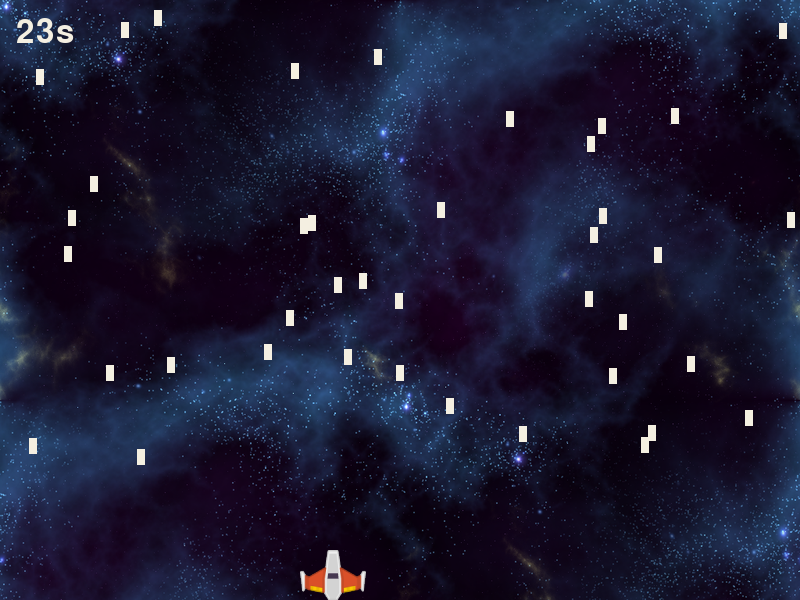
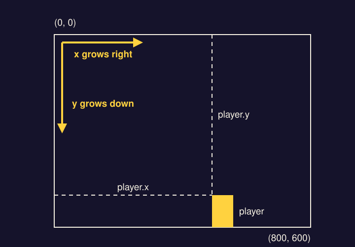
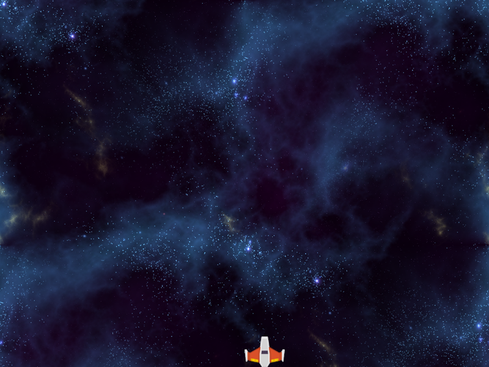
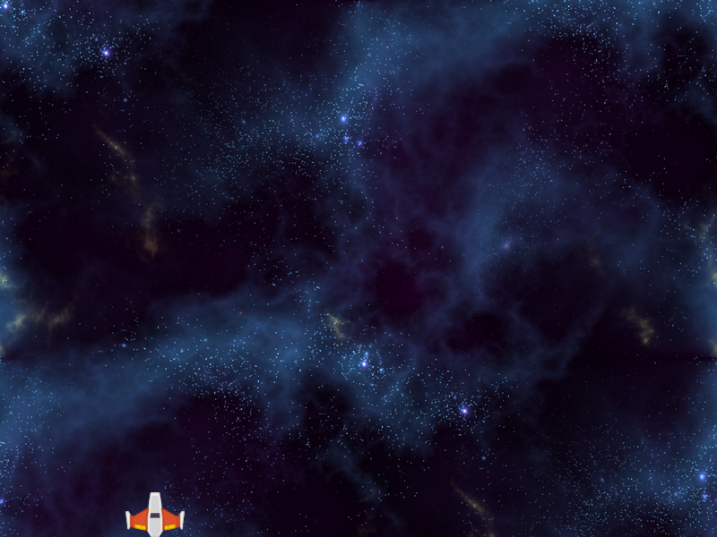
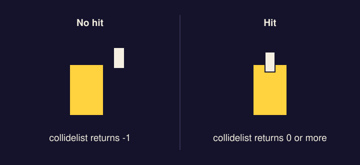
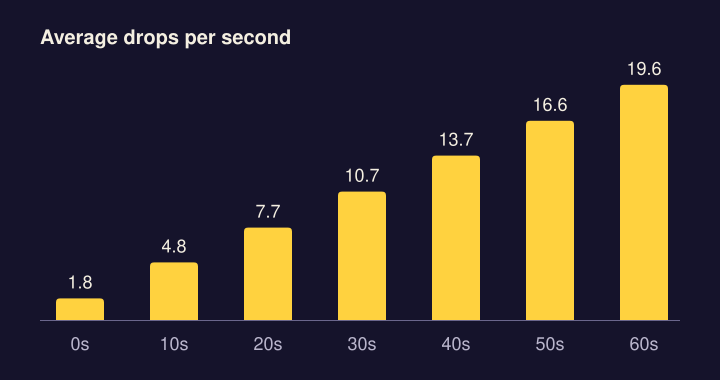
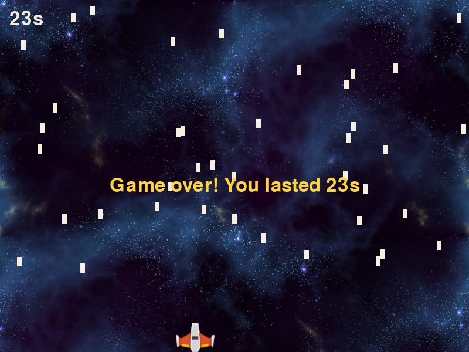

*The finished game. The timer in the corner is your score.*

## Get the files

Make a folder called `rain-dodge` and save both images into it.

- <a href="../downloads/rain-dodge/bg.png" download>Download bg.png</a> (the background)
- <a href="../downloads/rain-dodge/ship.png" download>Download ship.png</a> (the player)

Then make an empty file called `main.py` in the same folder. Make it from your code editor (File, New File, then save it as `main.py`) and not from Notepad, which quietly names it `main.py.txt`.

Open a terminal in that folder. If you're not sure how, see [Running a file from the terminal](../setup/#running-a-file-from-the-terminal).

## 1. Open a window

Every game runs the same loop, about 60 times a second:

1. **Events.** What did the player do? Did they close the window?
2. **Update.** Move things, spawn things, check for hits.
3. **Draw.** Paint the whole screen fresh, then show it.

For now the loop only checks one event, and the only thing it draws is the background. Type this into `main.py`. If a long line wraps onto a second row here, the second row has no line number. It's still one line, so type it as one.

```python title="main.py" showLineNumbers file=rain-dodge/step1.py
import random
import pygame

pygame.init()
WIDTH, HEIGHT = 800, 600
WIN = pygame.display.set_mode((WIDTH, HEIGHT))
pygame.display.set_caption("Rain Dodge")
CLOCK = pygame.time.Clock()
BG = pygame.transform.scale(pygame.image.load("bg.png"), (WIDTH, HEIGHT))

GOLD = (255, 210, 63)
CREAM = (244, 239, 225)

def draw():
    WIN.blit(BG, (0, 0))
    pygame.display.update()

def main():
    while True:
        CLOCK.tick(60)
        for event in pygame.event.get():
            if event.type == pygame.QUIT:
                return
        draw()

main()
pygame.quit()
```

What the less obvious lines do:

- `CLOCK.tick(60)` pauses so the loop runs at most 60 times a second. Without it the game would run faster on a faster computer.
- `WIN.blit(BG, (0, 0))` copies the background picture onto the window, starting at the top left corner.
- `pygame.display.update()` shows what you've drawn. Nothing appears on screen until this line runs.
- `GOLD` and `CREAM` are colors as amounts of red, green and blue. You'll use them in steps 4 and 5, and `random` in step 4.

:::tip[Checkpoint 1]
Run `py main.py` (Windows) or `python3 main.py` (Mac). A window showing space opens and stays open until you click the X.


| If you see | Do this |
| --- | --- |
| `can't open file` | The terminal isn't in the `rain-dodge` folder, or the file is really named `main.py.txt`. |
| `FileNotFoundError` | `bg.png` isn't next to `main.py`, or the terminal isn't in the `rain-dodge` folder. Move the image, or reopen the terminal from inside the folder. |
| `ModuleNotFoundError` | pygame isn't installed for the Python you're running. Go back to [Set up Python and pygame](../setup/). |
| `IndentationError` | A line starts with the wrong number of spaces. Match the code above exactly. Each level is four spaces. |
:::

## 2. Add the player

The player is a rectangle with the ship picture drawn on top of it. pygame's `Rect` holds a position and a size: x, y, width, height.

On screen, x grows to the right and **y grows downward**. The top left corner is (0, 0) and the bottom edge is `HEIGHT`, not 0. A rectangle's position is its top left corner, so to sit the ship on the bottom edge you start it at `HEIGHT - PLAYER_H`.



From here on you add to the code you already have. **Lines marked + are new. Lines marked ~ were already there and have changed.** The line numbers tell you where each piece goes.

```python title="main.py" showLineNumbers startLineNumber=14 ins={1-2,6,10} mark={4,16} file=rain-dodge/step2.py
PLAYER_W, PLAYER_H = 66, 50
SHIP = pygame.transform.smoothscale(pygame.image.load("ship.png"), (PLAYER_W, PLAYER_H))

def draw(player):
    WIN.blit(BG, (0, 0))
    WIN.blit(SHIP, player)
    pygame.display.update()

def main():
    player = pygame.Rect(WIDTH // 2, HEIGHT - PLAYER_H, PLAYER_W, PLAYER_H)
    while True:
        CLOCK.tick(60)
        for event in pygame.event.get():
            if event.type == pygame.QUIT:
                return
        draw(player)
```

:::tip[Checkpoint 2]
Run it again. The ship sits on the bottom edge of the window. It can't move yet.



| If you see | Do this |
| --- | --- |
| `FileNotFoundError` | `ship.png` isn't next to `main.py`. |
| `TypeError: draw() ...` | You changed `def draw(player)` on line 17 but not the call on line 29, or the other way round. |
:::

## 3. Move the ship

`pygame.key.get_pressed()` tells you which keys are held down right now. If the left arrow is down, move the ship left by `PLAYER_VEL` pixels, but only if that wouldn't push it off the screen. Same for the right.

```python title="main.py" showLineNumbers startLineNumber=14 ins={3,5-10} file=rain-dodge/step3.py
PLAYER_W, PLAYER_H = 66, 50
SHIP = pygame.transform.smoothscale(pygame.image.load("ship.png"), (PLAYER_W, PLAYER_H))
PLAYER_VEL = 6

def move_player(player):
    keys = pygame.key.get_pressed()
    if keys[pygame.K_LEFT] and player.left - PLAYER_VEL >= 0:
        player.x -= PLAYER_VEL
    if keys[pygame.K_RIGHT] and player.right + PLAYER_VEL <= WIDTH:
        player.x += PLAYER_VEL
```

A function does nothing until something calls it. Call `move_player` once per frame, in the update part of the loop.

```python title="main.py" showLineNumbers startLineNumber=30 ins={8} file=rain-dodge/step3.py
def main():
    player = pygame.Rect(WIDTH // 2, HEIGHT - PLAYER_H, PLAYER_W, PLAYER_H)
    while True:
        CLOCK.tick(60)
        for event in pygame.event.get():
            if event.type == pygame.QUIT:
                return
        move_player(player)
        draw(player)
```

:::tip[Checkpoint 3]
Run it. The arrow keys slide the ship left and right, and it stops at both edges.



| If this happens | Do this |
| --- | --- |
| The ship doesn't move | Click the game window first, so it's the one receiving your key presses. |
| It still doesn't move | Check that `move_player(player)` on line 37 is indented to line up with `draw(player)`, inside the `while` loop. |
| The ship slides off one edge | Compare lines 20 and 22 with the code above. The `>= 0` and `<= WIDTH` checks are what stop it. |
:::

## 4. Make it rain

Each raindrop is another `Rect`. All the drops live in one list. New code handles them: one function makes a new drop above the top of the screen, one moves every drop down and throws away the ones that have left the bottom, and a loop in `draw` paints them.

First the sizes and speed.

```python title="main.py" showLineNumbers startLineNumber=14 ins={4-5} file=rain-dodge/step4.py
PLAYER_W, PLAYER_H = 66, 50
SHIP = pygame.transform.smoothscale(pygame.image.load("ship.png"), (PLAYER_W, PLAYER_H))
PLAYER_VEL = 6
DROP_W, DROP_H = 8, 16
DROP_VEL = 5
```

Then two new functions, below `move_player`.

```python title="main.py" showLineNumbers startLineNumber=27 ins={1-3,5-9} file=rain-dodge/step4.py
def spawn_drop(drops):
    x = random.randint(0, WIDTH - DROP_W)
    drops.append(pygame.Rect(x, -DROP_H, DROP_W, DROP_H))

def move_drops(drops):
    for drop in drops[:]:
        drop.y += DROP_VEL
        if drop.top > HEIGHT:
            drops.remove(drop)
```

`drops[:]` on line 32 makes a copy of the list to loop over. Removing items from a list while you loop over that same list skips items, so you loop over the copy and remove from the original.

Draw the drops.

```python title="main.py" showLineNumbers startLineNumber=37 mark={1} ins={4-5} file=rain-dodge/step4.py
def draw(player, drops):
    WIN.blit(BG, (0, 0))
    WIN.blit(SHIP, player)
    for drop in drops:
        pygame.draw.rect(WIN, CREAM, drop)
    pygame.display.update()
```

And use all of it in the loop.

```python title="main.py" showLineNumbers startLineNumber=44 ins={3,10-12} mark={13} file=rain-dodge/step4.py
def main():
    player = pygame.Rect(WIDTH // 2, HEIGHT - PLAYER_H, PLAYER_W, PLAYER_H)
    drops = []
    while True:
        CLOCK.tick(60)
        for event in pygame.event.get():
            if event.type == pygame.QUIT:
                return
        move_player(player)
        if random.randint(0, 100) < 3:
            spawn_drop(drops)
        move_drops(drops)
        draw(player, drops)
```

Line 53 is how the game decides when to add a drop. `random.randint(0, 100)` picks one of 101 numbers, and three of them (0, 1 and 2) are less than 3. So each frame has about a 3% chance of a new drop, which at 60 frames a second comes to almost two drops a second.

:::tip[Checkpoint 4]
Run it. Rain falls, and for now it passes straight through the ship.


| If this happens | Do this |
| --- | --- |
| No rain | Lines 53 to 55 belong inside the `while` loop, lined up with `move_player(player)`. Also check that line 46, `drops = []`, comes before `while True:` and not inside the loop. |
| `NameError` mentioning `drops` | Line 46, `drops = []`, is missing. |
| The window fills with rain instantly | Check line 53. It should be `< 3`, not `> 3`. |
:::

## 5. Game over

This step adds a score, a way to lose, and rain that gets harder.

**The score** is how many seconds you've survived. `pygame.time.get_ticks()` counts milliseconds since the game started, so you save the starting count and subtract.

**Losing** uses `player.collidelist(drops)`. It checks the player's rectangle against every drop and returns the position in the list of the first one that overlaps (0 for the first drop, 1 for the second, and so on). If nothing overlaps it returns -1.



**Getting harder** is one change. The number on the right of the `<` was fixed at 3, about a 3% chance each frame. Now it's `3 + score // 2`, so the chance goes up by about one percentage point every two seconds.



You need a font to draw text. Add it under the other settings.

```python title="main.py" showLineNumbers startLineNumber=14 ins={6} file=rain-dodge/step5.py
PLAYER_W, PLAYER_H = 66, 50
SHIP = pygame.transform.smoothscale(pygame.image.load("ship.png"), (PLAYER_W, PLAYER_H))
PLAYER_VEL = 6
DROP_W, DROP_H = 8, 16
DROP_VEL = 5
FONT = pygame.font.Font(None, 48)
```

A new function shows the final message for three seconds. It goes below `move_drops`.

```python title="main.py" showLineNumbers startLineNumber=38 ins={1-5} file=rain-dodge/step5.py
def game_over(score):
    text = FONT.render(f"Game over! You lasted {score}s", True, GOLD)
    WIN.blit(text, (WIDTH // 2 - text.get_width() // 2, HEIGHT // 2))
    pygame.display.update()
    pygame.time.delay(3000)
```

`FONT.render` turns text into a picture, and then you `blit` it like any other picture. Subtracting half the text's width from the middle of the screen centers it.

Show the running score in the corner.

```python title="main.py" showLineNumbers startLineNumber=44 mark={1} ins={6} file=rain-dodge/step5.py
def draw(player, drops, score):
    WIN.blit(BG, (0, 0))
    WIN.blit(SHIP, player)
    for drop in drops:
        pygame.draw.rect(WIN, CREAM, drop)
    WIN.blit(FONT.render(f"{score}s", True, CREAM), (16, 16))
    pygame.display.update()
```

Last, the loop.

```python title="main.py" showLineNumbers startLineNumber=52 ins={4,10,15-17} mark={12,18} file=rain-dodge/step5.py
def main():
    player = pygame.Rect(WIDTH // 2, HEIGHT - PLAYER_H, PLAYER_W, PLAYER_H)
    drops = []
    start = pygame.time.get_ticks()
    while True:
        CLOCK.tick(60)
        for event in pygame.event.get():
            if event.type == pygame.QUIT:
                return
        score = (pygame.time.get_ticks() - start) // 1000
        move_player(player)
        if random.randint(0, 100) < 3 + score // 2:
            spawn_drop(drops)
        move_drops(drops)
        if player.collidelist(drops) != -1:
            game_over(score)
            return
        draw(player, drops, score)
```

:::tip[Checkpoint 5]
Run it and play. The timer counts up in the corner, the rain thickens, and when a drop touches the ship you get a gold message and the window closes three seconds later.



| If this happens | Do this |
| --- | --- |
| `UnboundLocalError` or `NameError` mentioning `score` | Line 61 is missing, or it comes after a line that uses `score`. It has to be above lines 63, 66 and 69. |
| `TypeError: draw() ...` | Lines 44 and 69 both need the third value, `score`. |
| The game ends the moment it starts | Check line 66 says `!= -1`. With `== -1` the game ends whenever nothing is touching you. |
| Drops pass through the ship | Lines 66 to 68 are missing or are outside the `while` loop. |
:::

## The finished code

If something still doesn't work, compare your file with this one.

<details>
<summary>All 72 lines of main.py</summary>

```python title="main.py" showLineNumbers file=rain-dodge/step5.py
import random
import pygame

pygame.init()
WIDTH, HEIGHT = 800, 600
WIN = pygame.display.set_mode((WIDTH, HEIGHT))
pygame.display.set_caption("Rain Dodge")
CLOCK = pygame.time.Clock()
BG = pygame.transform.scale(pygame.image.load("bg.png"), (WIDTH, HEIGHT))

GOLD = (255, 210, 63)
CREAM = (244, 239, 225)

PLAYER_W, PLAYER_H = 66, 50
SHIP = pygame.transform.smoothscale(pygame.image.load("ship.png"), (PLAYER_W, PLAYER_H))
PLAYER_VEL = 6
DROP_W, DROP_H = 8, 16
DROP_VEL = 5
FONT = pygame.font.Font(None, 48)

def move_player(player):
    keys = pygame.key.get_pressed()
    if keys[pygame.K_LEFT] and player.left - PLAYER_VEL >= 0:
        player.x -= PLAYER_VEL
    if keys[pygame.K_RIGHT] and player.right + PLAYER_VEL <= WIDTH:
        player.x += PLAYER_VEL

def spawn_drop(drops):
    x = random.randint(0, WIDTH - DROP_W)
    drops.append(pygame.Rect(x, -DROP_H, DROP_W, DROP_H))

def move_drops(drops):
    for drop in drops[:]:
        drop.y += DROP_VEL
        if drop.top > HEIGHT:
            drops.remove(drop)

def game_over(score):
    text = FONT.render(f"Game over! You lasted {score}s", True, GOLD)
    WIN.blit(text, (WIDTH // 2 - text.get_width() // 2, HEIGHT // 2))
    pygame.display.update()
    pygame.time.delay(3000)

def draw(player, drops, score):
    WIN.blit(BG, (0, 0))
    WIN.blit(SHIP, player)
    for drop in drops:
        pygame.draw.rect(WIN, CREAM, drop)
    WIN.blit(FONT.render(f"{score}s", True, CREAM), (16, 16))
    pygame.display.update()

def main():
    player = pygame.Rect(WIDTH // 2, HEIGHT - PLAYER_H, PLAYER_W, PLAYER_H)
    drops = []
    start = pygame.time.get_ticks()
    while True:
        CLOCK.tick(60)
        for event in pygame.event.get():
            if event.type == pygame.QUIT:
                return
        score = (pygame.time.get_ticks() - start) // 1000
        move_player(player)
        if random.randint(0, 100) < 3 + score // 2:
            spawn_drop(drops)
        move_drops(drops)
        if player.collidelist(drops) != -1:
            game_over(score)
            return
        draw(player, drops, score)

main()
pygame.quit()
```

</details>

## Challenges

Things to try on your own, roughly easiest first.

- **Speed boost.** Hold Shift to move faster. `pygame.K_LSHIFT` is the key's name.
- **Wind.** Make the drops drift sideways as they fall.
- **Player art.** Swap `ship.png` for a drawing made of shapes with `pygame.draw`.

The next tutorial works through more: three lives, pressing R to restart, and a high score that saves.

Rain Dodge is inspired by [Tech With Tim's Python game development tutorial](https://www.youtube.com/watch?v=waY3LfJhQLY).
