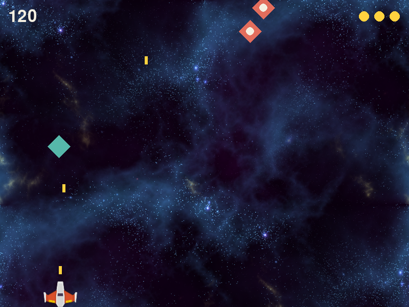
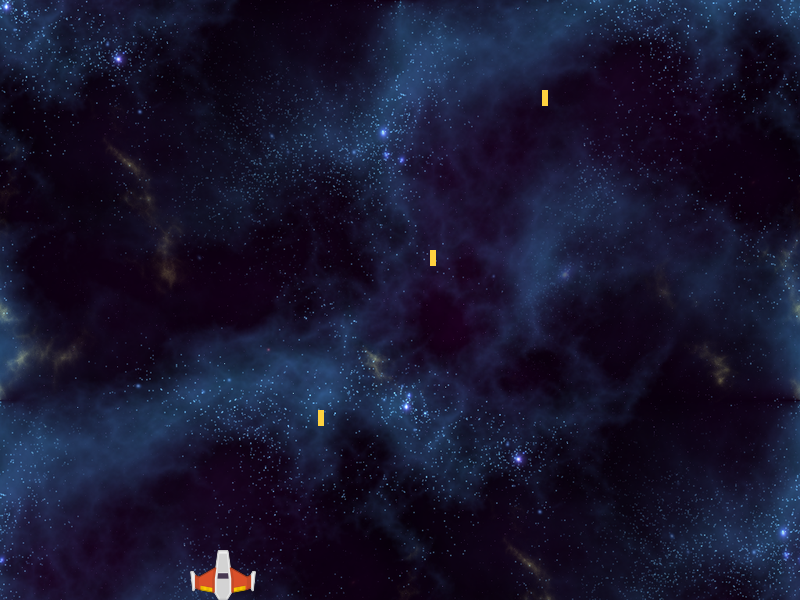
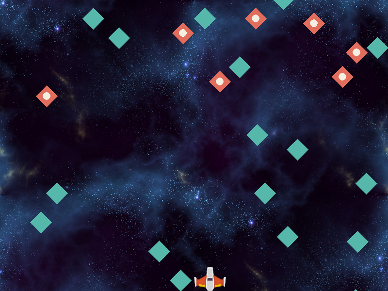
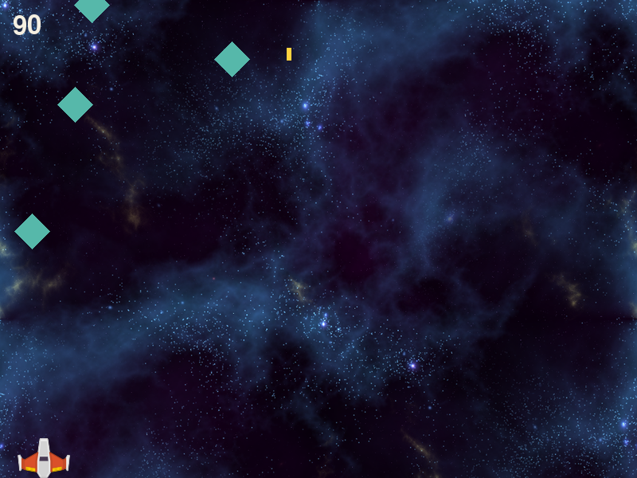
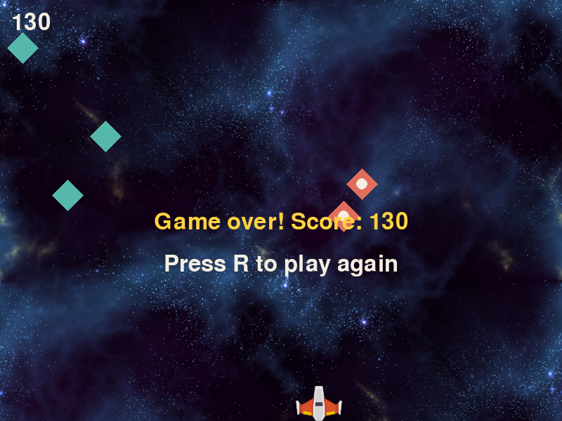

*The finished game. Teal drifters take one hit. Coral ones take two.*

In Rain Dodge all you could do was get out of the way. Here you shoot. Two things are new. Firing happens once per key press, which works differently from the held keys that move the ship. And an enemy needs more than a `Rect`: it has its own speed, its own health and its own color. That is what a class is for, and step 3 is where you write your first one.

## Get the files

Make a folder called `shoot-back` and save all four files into it. The two images are the same ones Rain Dodge used, so you can copy them from your `rain-dodge` folder if you still have it.

- <a href="../downloads/shoot-back/bg.png" download>Download bg.png</a> (the background)
- <a href="../downloads/shoot-back/ship.png" download>Download ship.png</a> (the player)
- <a href="../downloads/shoot-back/shoot.wav" download>Download shoot.wav</a> (firing)
- <a href="../downloads/shoot-back/hit.wav" download>Download hit.wav</a> (a bullet landing)

Then make an empty file called `main.py` in the same folder and open a terminal there.

## 1. A ship that moves

You start from an empty file again. That is deliberate. You have typed the loop (events, update, draw) in every game so far, and by now you should be able to write most of it from memory. Try typing `main` without looking, then compare.

Nothing in this step is new. It is the first three steps of [Rain Dodge](../rain-dodge/) in one go: a window, a `Rect` for the player with the ship picture on top, and held arrow keys to slide it.

```python title="main.py" showLineNumbers file=shoot-back/step1.py
import random
import pygame

pygame.init()
WIDTH, HEIGHT = 800, 600
WIN = pygame.display.set_mode((WIDTH, HEIGHT))
pygame.display.set_caption("Shoot Back")
CLOCK = pygame.time.Clock()
BG = pygame.transform.scale(pygame.image.load("bg.png"), (WIDTH, HEIGHT))

GOLD = (255, 210, 63)
CREAM = (244, 239, 225)
TEAL = (86, 184, 170)
CORAL = (226, 109, 92)

PLAYER_W, PLAYER_H = 66, 50
SHIP = pygame.image.load("ship.png")
SHIP = pygame.transform.smoothscale(SHIP, (PLAYER_W, PLAYER_H))
PLAYER_VEL = 7

def move_player(player):
    keys = pygame.key.get_pressed()
    if keys[pygame.K_LEFT] and player.left - PLAYER_VEL >= 0:
        player.x -= PLAYER_VEL
    if keys[pygame.K_RIGHT] and player.right + PLAYER_VEL <= WIDTH:
        player.x += PLAYER_VEL

def draw(player):
    WIN.blit(BG, (0, 0))
    WIN.blit(SHIP, player)
    pygame.display.update()

def main():
    player = pygame.Rect(WIDTH // 2, HEIGHT - PLAYER_H, PLAYER_W, PLAYER_H)
    while True:
        CLOCK.tick(60)
        for event in pygame.event.get():
            if event.type == pygame.QUIT:
                return
        move_player(player)
        draw(player)

main()
pygame.quit()
```

Lines 17 and 18 load the ship and shrink it in two lines where Rain Dodge used one long line. The result is the same. `random` and the four colors are for later steps.

:::tip[Checkpoint 1]
Run `py main.py` (Windows) or `python3 main.py` (Mac). The ship sits on the bottom edge of a starfield. The arrow keys slide it left and right and it stops at both edges.


| If this happens | Do this |
| --- | --- |
| `FileNotFoundError: No file 'ship.png' found in working directory` | The image named in the message isn't next to `main.py`, or the terminal isn't in the `shoot-back` folder. |
| The ship doesn't move | Click the game window first. Then check that `move_player(player)` on line 40 lines up with `draw(player)`, inside the `while` loop. |
| The ship slides off one edge | Compare lines 23 and 25 with the code above. The `>= 0` and `<= WIDTH` checks are what stop it. |
:::

## 2. Fire

The ship moves with `pygame.key.get_pressed()`, which answers "is this key down right now?" 60 times a second. That is right for movement: hold the key, keep moving. It is wrong for firing. Hold Space for one second and you would get 60 bullets.

Firing should happen once per press. pygame sends a `KEYDOWN` event at the moment a key goes down, and sends nothing more while the key stays held. You used this in [Extend Rain Dodge](../extend-rain-dodge/) to catch the R key. Here the key is `pygame.K_SPACE`.

One bullet per press still lets a player who hammers the key fill the screen. A **cooldown** stops that. The game remembers the time of the last shot in `last_shot`, and a press only counts if at least `COOLDOWN` milliseconds have passed since then. The time comes from `pygame.time.get_ticks()`, the same millisecond counter that kept the score in Rain Dodge. With a cooldown of 250 you get at most four shots a second.

Add three settings under the others.

```python title="main.py" showLineNumbers startLineNumber=16 ins={5-7} file=shoot-back/step2.py
PLAYER_W, PLAYER_H = 66, 50
SHIP = pygame.image.load("ship.png")
SHIP = pygame.transform.smoothscale(SHIP, (PLAYER_W, PLAYER_H))
PLAYER_VEL = 7
BULLET_VEL = 10
COOLDOWN = 250
SHOOT = pygame.mixer.Sound("shoot.wav")
```

A bullet is a small `Rect`, and all the bullets live in one list, the way the raindrops did. Two new functions go below `move_player`.

```python title="main.py" showLineNumbers startLineNumber=31 ins={1-3,5-9} file=shoot-back/step2.py
def fire(player, bullets):
    bullets.append(pygame.Rect(player.centerx - 3, player.top, 6, 16))
    SHOOT.play()

def move_bullets(bullets):
    for bullet in bullets[:]:
        bullet.y -= BULLET_VEL
        if bullet.bottom < 0:
            bullets.remove(bullet)
```

`player.centerx` is the x of the middle of the ship. The bullet is 6 wide, so starting it 3 to the left of that puts it in the centre of the nose. `move_bullets` is `move_drops` from Rain Dodge turned upside down: y goes down by `BULLET_VEL` each frame because up the screen is smaller y, and a bullet is thrown away once its bottom edge is above the top of the window. It loops over the copy `bullets[:]` for the same reason as before, so removing from the real list doesn't skip anything.

Draw the bullets before the ship, so a new bullet appears to come out from under the nose.

```python title="main.py" showLineNumbers startLineNumber=41 mark={1} ins={3-4} file=shoot-back/step2.py
def draw(player, bullets):
    WIN.blit(BG, (0, 0))
    for bullet in bullets:
        pygame.draw.rect(WIN, GOLD, bullet)
    WIN.blit(SHIP, player)
    pygame.display.update()
```

Now the loop. The new `if` on line 57 sits inside the `for event` loop, level with the `QUIT` check, because a key press is an event.

```python title="main.py" showLineNumbers startLineNumber=48 ins={3-4,10-14,16} mark={17} file=shoot-back/step2.py
def main():
    player = pygame.Rect(WIDTH // 2, HEIGHT - PLAYER_H, PLAYER_W, PLAYER_H)
    bullets = []
    last_shot = 0
    while True:
        CLOCK.tick(60)
        for event in pygame.event.get():
            if event.type == pygame.QUIT:
                return
            if event.type == pygame.KEYDOWN and event.key == pygame.K_SPACE:
                now = pygame.time.get_ticks()
                if now - last_shot >= COOLDOWN:
                    fire(player, bullets)
                    last_shot = now
        move_player(player)
        move_bullets(bullets)
        draw(player, bullets)
```

Line 59 is the cooldown. `now - last_shot` is how long it has been since the last bullet. If that is long enough, fire, and line 61 writes down the new time. If it isn't, the press is ignored.

:::tip[Checkpoint 2]
Run it. Each press of Space fires one gold bullet from the nose of the ship, with a sound. Holding Space fires once. Pressing it as fast as you can gives a steady line of bullets with gaps between them, never a solid stream. You can move and fire at the same time.



| If this happens | Do this |
| --- | --- |
| `FileNotFoundError: No file 'shoot.wav' found in working directory` | `shoot.wav` isn't next to `main.py`. |
| `UnboundLocalError` mentioning `last_shot` | Line 51, `last_shot = 0`, is missing. |
| `TypeError: list.append() takes exactly one argument (4 given)` | On line 32 the four numbers have to be wrapped in `pygame.Rect(...)`. Count the brackets at the end of the line: there are two. |
| Space does nothing | Click the game window first. Then check that line 57 is indented to line up with the `if` on line 55, inside the `for` loop. |
| Hammering Space gives a solid stream | Line 61, `last_shot = now`, is missing, or line 51 is inside the `while` loop, where it resets the time every frame. |
:::

## 3. Enemies, and your first class

Think about what an enemy has to remember. In Rain Dodge a drop was a `Rect`, because a position and a size were all it had, and every drop fell at the same `DROP_VEL`. In [Pop](../pop/) a target needed a few more facts, so each one was a dict. An enemy here needs four: where it is, how fast it falls, how many hits it can take, and what color it is.

A dict could hold those four. But the code that uses them would still be spread around the file: a line in `main` that reaches into each dict to move it, more lines in `draw` that reach in again to paint it. Every new fact about enemies would mean changes in three places.

A **class** keeps the facts and the code that uses them in one place. It is a description of a kind of thing: what each one remembers, and what each one can do. Here is the first half. Add the size to the settings, then start the class below `move_bullets`.

```python title="main.py" showLineNumbers startLineNumber=19 ins={5} file=shoot-back/step3.py
PLAYER_VEL = 7
BULLET_VEL = 10
COOLDOWN = 250
SHOOT = pygame.mixer.Sound("shoot.wav")
ENEMY_SIZE = 44
```

```python title="main.py" showLineNumbers startLineNumber=42 ins={1-6} file=shoot-back/step3.py
class Enemy:
    def __init__(self, x, speed, health, color):
        self.rect = pygame.Rect(x, -ENEMY_SIZE, ENEMY_SIZE, ENEMY_SIZE)
        self.speed = speed
        self.health = health
        self.color = color
```

Read it from the outside in.

- `class Enemy:` says "here is a new kind of thing called Enemy". Class names start with a capital letter. On its own this line makes no enemies, the same way `def` on its own runs nothing.
- You make one by calling the class like a function: `Enemy(300, 2, 1, TEAL)`. Each thing you make this way is called an **object**.
- `__init__` (two underscores on each side) is the function Python runs every time you make one. Its job is to set the new enemy up.
- `self` means **this particular enemy**, the one being set up right now. `self.speed = speed` reads as "store the speed I was given on this enemy". Once it is stored, it stays with that enemy. Make ten enemies and there are ten separate `speed` values, one on each.

You never pass `self` yourself. `Enemy(300, 2, 1, TEAL)` gives four values, and `__init__` has five names in its brackets, because Python fills in `self` for you.

Every enemy starts with its `rect` one enemy-height above the top of the window, at whatever x it was given, so it slides into view.

Now the second half: what an enemy can do. These two functions go inside the class, indented one level, with a blank line between them.

```python title="main.py" showLineNumbers startLineNumber=49 ins={1-2,4-9} file=shoot-back/step3.py
    def update(self):
        self.rect.y += self.speed

    def draw(self):
        r = self.rect
        points = [r.midtop, r.midright, r.midbottom, r.midleft]
        pygame.draw.polygon(WIN, self.color, points)
        if self.health == 2:
            pygame.draw.circle(WIN, CREAM, r.center, 8)
```

A function that belongs to a class is called a **method**. You call it with a dot: `enemy.update()`. Whatever is in front of the dot arrives in the method as `self`. So `update` moves this particular enemy down by its own speed, and `draw` paints this particular enemy in its own color.

You have been calling methods since Rain Dodge. `player.colliderect(...)`, `drops.append(...)` and `SHOOT.play()` are all methods, and `pygame.Rect` is a class that someone else wrote. `player.x` is a fact stored on one particular Rect. The only new thing is that this time you are the one writing the class.

`draw` gives the drifters their look. `midtop`, `midright`, `midbottom` and `midleft` are the middles of a Rect's four edges, and `pygame.draw.polygon` joins a list of points into a filled shape, so those four make a diamond. An enemy with 2 health also gets a cream dot in the middle. After one hit its health is 1 and the dot is gone, which shows the player that the hit counted.

Next, a function that makes enemies. It goes below the class, back at the left margin.

```python title="main.py" showLineNumbers startLineNumber=59 ins={1-6} file=shoot-back/step3.py
def spawn_enemy(enemies):
    x = random.randint(0, WIDTH - ENEMY_SIZE)
    if random.randint(1, 4) == 1:
        enemies.append(Enemy(x, 1, 2, CORAL))
    else:
        enemies.append(Enemy(x, random.randint(2, 4), 1, TEAL))
```

One time in four you get a slow coral drifter with 2 health. The rest are teal, with 1 health and a speed of 2, 3 or 4 pixels a frame. Both come from the same class. Only the values handed to `__init__` differ. Speeds are whole numbers because a Rect stores whole pixels.

Drawing every enemy takes two lines, because each enemy knows how to draw itself.

```python title="main.py" showLineNumbers startLineNumber=66 mark={1} ins={5-6} file=shoot-back/step3.py
def draw(player, bullets, enemies):
    WIN.blit(BG, (0, 0))
    for bullet in bullets:
        pygame.draw.rect(WIN, GOLD, bullet)
    for enemy in enemies:
        enemy.draw()
    WIN.blit(SHIP, player)
    pygame.display.update()
```

And the loop.

```python title="main.py" showLineNumbers startLineNumber=75 ins={4,18-23} mark={24} file=shoot-back/step3.py
def main():
    player = pygame.Rect(WIDTH // 2, HEIGHT - PLAYER_H, PLAYER_W, PLAYER_H)
    bullets = []
    enemies = []
    last_shot = 0
    while True:
        CLOCK.tick(60)
        for event in pygame.event.get():
            if event.type == pygame.QUIT:
                return
            if event.type == pygame.KEYDOWN and event.key == pygame.K_SPACE:
                now = pygame.time.get_ticks()
                if now - last_shot >= COOLDOWN:
                    fire(player, bullets)
                    last_shot = now
        move_player(player)
        move_bullets(bullets)
        if random.randint(0, 100) < 2:
            spawn_enemy(enemies)
        for enemy in enemies[:]:
            enemy.update()
            if enemy.rect.top > HEIGHT:
                enemies.remove(enemy)
        draw(player, bullets, enemies)
```

Line 92 is the spawn chance from Rain Dodge: about 2% each frame, a little more than one enemy a second. Look at lines 95 and 71. The main loop and `draw` don't know how an enemy moves or what it looks like. They say `enemy.update()` and `enemy.draw()` and the enemy does the rest. Because `rect` is now stored on the enemy, line 96 reaches it as `enemy.rect`.

:::tip[Checkpoint 3]
Run it. Diamonds drift down from the top: teal ones at different speeds, and now and then a slow coral one with a cream dot. Your bullets pass straight through them for now. Yours will be less crowded than this picture, which was taken with extra enemies so that both kinds show.



| If this happens | Do this |
| --- | --- |
| `TypeError: Enemy() takes no arguments` | Line 43 needs two underscores on each side: `__init__`. With one, Python doesn't recognise it as the set-up function. |
| `TypeError: Enemy.update() takes 0 positional arguments but 1 was given` | `self` is missing from the brackets on line 49. The same message naming `draw` points at line 52. |
| `NameError: name 'rect' is not defined` | Inside a method, everything stored on the enemy needs `self.` in front. Check lines 50 and 53. The same goes for `speed`, `health` and `color`. |
| `AttributeError: 'Enemy' object has no attribute 'speed'` | The line in `__init__` that stores that name is missing or spelled differently. Compare lines 44 to 47 with the code above. |
| No error, but no enemies | Line 71 needs its brackets: `enemy.draw()`. Without them nothing is called. Also check that lines 92 to 97 are inside the `while` loop. |
:::

## 4. Hit them

So far you have checked one thing against a list: the ship against every drop, with `collidelist`. Now there are two lists, and any bullet can hit any enemy. The plain way to check that is a loop inside a loop, like the one that built the grid in [Brick Buster](../brick-buster/): for each bullet, look at each enemy.

`bullet.colliderect(enemy.rect)` asks about one pair. It is `True` if the two rects overlap. When they do, three things happen:

1. The bullet is removed.
2. The enemy loses one health.
3. If its health has reached 0, the enemy is removed too.

Load the second sound and a font for the score.

```python title="main.py" showLineNumbers startLineNumber=19 ins={6-7} file=shoot-back/step4.py
PLAYER_VEL = 7
BULLET_VEL = 10
COOLDOWN = 250
SHOOT = pygame.mixer.Sound("shoot.wav")
ENEMY_SIZE = 44
HIT = pygame.mixer.Sound("hit.wav")
FONT = pygame.font.Font(None, 48)
```

The new function goes below `spawn_enemy`.

```python title="main.py" showLineNumbers startLineNumber=68 ins={1-13} file=shoot-back/step4.py
def hit_enemies(bullets, enemies):
    points = 0
    for bullet in bullets[:]:
        for enemy in enemies[:]:
            if bullet.colliderect(enemy.rect):
                bullets.remove(bullet)
                enemy.health -= 1
                if enemy.health == 0:
                    enemies.remove(enemy)
                HIT.play()
                points += 10
                break
    return points
```

Both loops go over copies, `bullets[:]` and `enemies[:]`, because this function removes from both lists while it is looping. You saw the same thing with `targets[:]` in Pop.

`break` on line 79 leaves the inner loop early. Once a bullet has hit something it is gone, so there is no point checking it against the rest of the enemies. It is more than tidiness: if the bullet happened to overlap two enemies at once, the second `bullets.remove(bullet)` would crash, because the bullet is no longer in the list. After the `break`, the outer loop carries on with the next bullet.

Line 74 changes a value stored on one enemy from outside the class. That is allowed. `enemy.health` is that enemy's own number, and the next time its `draw` runs it will see the new value and leave out the cream dot.

The function counts 10 points for every hit and returns the total, so a coral drifter is worth 20 in the end. It returns the points because `score` lives in `main`. A function can change a list it is given, but it cannot change a number that belongs to another function. So it hands the points back and `main` adds them on.

Show the score in the corner.

```python title="main.py" showLineNumbers startLineNumber=82 mark={1} ins={8} file=shoot-back/step4.py
def draw(player, bullets, enemies, score):
    WIN.blit(BG, (0, 0))
    for bullet in bullets:
        pygame.draw.rect(WIN, GOLD, bullet)
    for enemy in enemies:
        enemy.draw()
    WIN.blit(SHIP, player)
    WIN.blit(FONT.render(f"{score}", True, CREAM), (16, 16))
    pygame.display.update()
```

Three lines of `main` change. The middle of the function is the same as before.

```python title="main.py" showLineNumbers startLineNumber=92 ins={6,25} mark={26} file=shoot-back/step4.py
def main():
    player = pygame.Rect(WIDTH // 2, HEIGHT - PLAYER_H, PLAYER_W, PLAYER_H)
    bullets = []
    enemies = []
    last_shot = 0
    score = 0
    while True:
        CLOCK.tick(60)
        for event in pygame.event.get():
            if event.type == pygame.QUIT:
                return
            if event.type == pygame.KEYDOWN and event.key == pygame.K_SPACE:
                now = pygame.time.get_ticks()
                if now - last_shot >= COOLDOWN:
                    fire(player, bullets)
                    last_shot = now
        move_player(player)
        move_bullets(bullets)
        if random.randint(0, 100) < 2:
            spawn_enemy(enemies)
        for enemy in enemies[:]:
            enemy.update()
            if enemy.rect.top > HEIGHT:
                enemies.remove(enemy)
        score += hit_enemies(bullets, enemies)
        draw(player, bullets, enemies, score)
```

:::tip[Checkpoint 4]
Run it and shoot. A teal drifter disappears on the first hit. A coral one loses its dot on the first hit and disappears on the second. Every hit plays a sound, uses up the bullet and adds 10 to the score in the corner. Enemies you miss still fall off the bottom with no penalty.



| If this happens | Do this |
| --- | --- |
| `ValueError: list.remove(x): x not in list` | `break` on line 79 is missing. It lines up with `points += 10` above it. |
| `TypeError: unsupported operand type(s) for +=: 'int' and 'NoneType'` | Line 80, `return points`, is missing. It lines up with the first `for`, on line 70. |
| `UnboundLocalError` mentioning `score` | Line 97, `score = 0`, is missing. |
| Coral drifters die in one hit | Line 76 has to be indented under the `if` on line 75, so an enemy is only removed when its health is 0. |
| Only one bullet on screen can ever hit | Line 80 is indented too far, so the function returns after the first bullet. Move it back to line up with line 70. |
:::

## 5. Lives and game over

Right now nothing can go wrong for the player. This step makes an enemy cost a life in two ways: by getting past you to the bottom of the window, or by touching the ship. Three lives, then a game-over screen with the score and R to play again. All of that is the pattern from [Extend Rain Dodge](../extend-rain-dodge/). The enemies also start to arrive faster as your score climbs.

Start with `game_over`, below `hit_enemies`. It is the function you wrote in lesson 3 with different words in the message.

```python title="main.py" showLineNumbers startLineNumber=82 ins={1-13} file=shoot-back/step5.py
def game_over(score):
    text = FONT.render(f"Game over! Score: {score}", True, GOLD)
    WIN.blit(text, (WIDTH // 2 - text.get_width() // 2, HEIGHT // 2))
    hint = FONT.render("Press R to play again", True, CREAM)
    WIN.blit(hint, (WIDTH // 2 - hint.get_width() // 2, HEIGHT // 2 + 60))
    pygame.display.update()
    while True:
        CLOCK.tick(60)
        for event in pygame.event.get():
            if event.type == pygame.QUIT:
                return False
            if event.type == pygame.KEYDOWN and event.key == pygame.K_r:
                return True
```

Lives are shown as gold dots in the top right corner, one per life.

```python title="main.py" showLineNumbers startLineNumber=96 mark={1} ins={9-10} file=shoot-back/step5.py
def draw(player, bullets, enemies, score, lives):
    WIN.blit(BG, (0, 0))
    for bullet in bullets:
        pygame.draw.rect(WIN, GOLD, bullet)
    for enemy in enemies:
        enemy.draw()
    WIN.blit(SHIP, player)
    WIN.blit(FONT.render(f"{score}", True, CREAM), (16, 16))
    for i in range(lives):
        pygame.draw.circle(WIN, GOLD, (WIDTH - 28 - i * 30, 32), 10)
    pygame.display.update()
```

`i` counts 0, 1, 2, and each dot is drawn 30 pixels further left than the one before.

Now `main`.

```python title="main.py" showLineNumbers startLineNumber=108 ins={7,26,29-30} mark={12,20,24,28} file=shoot-back/step5.py
def main():
    player = pygame.Rect(WIDTH // 2, HEIGHT - PLAYER_H, PLAYER_W, PLAYER_H)
    bullets = []
    enemies = []
    last_shot = 0
    score = 0
    lives = 3
    while True:
        CLOCK.tick(60)
        for event in pygame.event.get():
            if event.type == pygame.QUIT:
                return False
            if event.type == pygame.KEYDOWN and event.key == pygame.K_SPACE:
                now = pygame.time.get_ticks()
                if now - last_shot >= COOLDOWN:
                    fire(player, bullets)
                    last_shot = now
        move_player(player)
        move_bullets(bullets)
        if random.randint(0, 100) < 2 + score // 200:
            spawn_enemy(enemies)
        for enemy in enemies[:]:
            enemy.update()
            if enemy.rect.top > HEIGHT or enemy.rect.colliderect(player):
                enemies.remove(enemy)
                lives -= 1
        score += hit_enemies(bullets, enemies)
        draw(player, bullets, enemies, score, lives)
        if lives <= 0:
            return game_over(score)
```

What changed, top to bottom:

- Line 119 returns `False` when the window is closed, as in lesson 3, so the loop at the bottom of the file knows to stop.
- Line 127 is the difficulty. The chance of a new enemy each frame was fixed at 2%. Now it goes up by one point for every 200 points you score. It is the same idea as the thickening rain in Rain Dodge, tied to score in place of time.
- Line 131 adds the second way to lose a life. The enemy is removed in both cases, and for the same reason the drop was removed in lesson 3: if it stayed, it would still be touching the ship on the next frame and take another life.
- Lines 136 and 137 end the game. The check is `<= 0` and not `== 0` because two enemies can get through on the same frame, which would take lives from 1 straight to -1. It comes after `draw` so the last gold dot disappears before the message appears. That is one fix for the stale counter you were asked about at the end of lesson 3.

Last, the bottom of the file.

```python title="main.py" showLineNumbers startLineNumber=139 mark={1} ins={2} file=shoot-back/step5.py
while main():
    pass
pygame.quit()
```

:::tip[Checkpoint 5]
Run it and play. Three gold dots sit in the top right. Each drifter that reaches the bottom or touches the ship removes one. When the last dot goes, a gold message shows your score, and R starts a new game with 0 points and three dots. The longer you last, the more drifters arrive at once.



| If this happens | Do this |
| --- | --- |
| `UnboundLocalError` mentioning `lives` | Line 114, `lives = 3`, is missing. |
| `TypeError: draw() ...` | Lines 96 and 135 both need the fifth value, `lives`. |
| R does nothing on the game-over screen | Line 137 needs the word `return` in front of `game_over(score)`. Without it the game carries on with no lives and ends again at once. |
| All three lives vanish when one drifter touches the ship | Line 132, `enemies.remove(enemy)`, is missing or isn't indented under the `if` on line 131. |
| The window closes when you press R | The file should end with `while main():` and `pass` on lines 139 and 140, not a plain `main()`. |
:::

## The finished code

If something still doesn't work, compare your file with this one.

<details>
<summary>All 141 lines of main.py</summary>

```python title="main.py" showLineNumbers file=shoot-back/step5.py
import random
import pygame

pygame.init()
WIDTH, HEIGHT = 800, 600
WIN = pygame.display.set_mode((WIDTH, HEIGHT))
pygame.display.set_caption("Shoot Back")
CLOCK = pygame.time.Clock()
BG = pygame.transform.scale(pygame.image.load("bg.png"), (WIDTH, HEIGHT))

GOLD = (255, 210, 63)
CREAM = (244, 239, 225)
TEAL = (86, 184, 170)
CORAL = (226, 109, 92)

PLAYER_W, PLAYER_H = 66, 50
SHIP = pygame.image.load("ship.png")
SHIP = pygame.transform.smoothscale(SHIP, (PLAYER_W, PLAYER_H))
PLAYER_VEL = 7
BULLET_VEL = 10
COOLDOWN = 250
SHOOT = pygame.mixer.Sound("shoot.wav")
ENEMY_SIZE = 44
HIT = pygame.mixer.Sound("hit.wav")
FONT = pygame.font.Font(None, 48)

def move_player(player):
    keys = pygame.key.get_pressed()
    if keys[pygame.K_LEFT] and player.left - PLAYER_VEL >= 0:
        player.x -= PLAYER_VEL
    if keys[pygame.K_RIGHT] and player.right + PLAYER_VEL <= WIDTH:
        player.x += PLAYER_VEL

def fire(player, bullets):
    bullets.append(pygame.Rect(player.centerx - 3, player.top, 6, 16))
    SHOOT.play()

def move_bullets(bullets):
    for bullet in bullets[:]:
        bullet.y -= BULLET_VEL
        if bullet.bottom < 0:
            bullets.remove(bullet)

class Enemy:
    def __init__(self, x, speed, health, color):
        self.rect = pygame.Rect(x, -ENEMY_SIZE, ENEMY_SIZE, ENEMY_SIZE)
        self.speed = speed
        self.health = health
        self.color = color

    def update(self):
        self.rect.y += self.speed

    def draw(self):
        r = self.rect
        points = [r.midtop, r.midright, r.midbottom, r.midleft]
        pygame.draw.polygon(WIN, self.color, points)
        if self.health == 2:
            pygame.draw.circle(WIN, CREAM, r.center, 8)

def spawn_enemy(enemies):
    x = random.randint(0, WIDTH - ENEMY_SIZE)
    if random.randint(1, 4) == 1:
        enemies.append(Enemy(x, 1, 2, CORAL))
    else:
        enemies.append(Enemy(x, random.randint(2, 4), 1, TEAL))

def hit_enemies(bullets, enemies):
    points = 0
    for bullet in bullets[:]:
        for enemy in enemies[:]:
            if bullet.colliderect(enemy.rect):
                bullets.remove(bullet)
                enemy.health -= 1
                if enemy.health == 0:
                    enemies.remove(enemy)
                HIT.play()
                points += 10
                break
    return points

def game_over(score):
    text = FONT.render(f"Game over! Score: {score}", True, GOLD)
    WIN.blit(text, (WIDTH // 2 - text.get_width() // 2, HEIGHT // 2))
    hint = FONT.render("Press R to play again", True, CREAM)
    WIN.blit(hint, (WIDTH // 2 - hint.get_width() // 2, HEIGHT // 2 + 60))
    pygame.display.update()
    while True:
        CLOCK.tick(60)
        for event in pygame.event.get():
            if event.type == pygame.QUIT:
                return False
            if event.type == pygame.KEYDOWN and event.key == pygame.K_r:
                return True

def draw(player, bullets, enemies, score, lives):
    WIN.blit(BG, (0, 0))
    for bullet in bullets:
        pygame.draw.rect(WIN, GOLD, bullet)
    for enemy in enemies:
        enemy.draw()
    WIN.blit(SHIP, player)
    WIN.blit(FONT.render(f"{score}", True, CREAM), (16, 16))
    for i in range(lives):
        pygame.draw.circle(WIN, GOLD, (WIDTH - 28 - i * 30, 32), 10)
    pygame.display.update()

def main():
    player = pygame.Rect(WIDTH // 2, HEIGHT - PLAYER_H, PLAYER_W, PLAYER_H)
    bullets = []
    enemies = []
    last_shot = 0
    score = 0
    lives = 3
    while True:
        CLOCK.tick(60)
        for event in pygame.event.get():
            if event.type == pygame.QUIT:
                return False
            if event.type == pygame.KEYDOWN and event.key == pygame.K_SPACE:
                now = pygame.time.get_ticks()
                if now - last_shot >= COOLDOWN:
                    fire(player, bullets)
                    last_shot = now
        move_player(player)
        move_bullets(bullets)
        if random.randint(0, 100) < 2 + score // 200:
            spawn_enemy(enemies)
        for enemy in enemies[:]:
            enemy.update()
            if enemy.rect.top > HEIGHT or enemy.rect.colliderect(player):
                enemies.remove(enemy)
                lives -= 1
        score += hit_enemies(bullets, enemies)
        draw(player, bullets, enemies, score, lives)
        if lives <= 0:
            return game_over(score)

while main():
    pass
pygame.quit()
```

</details>

The class is the part of this lesson to take into your own game. Every new kind of thing in a game (a pickup, a boss, an explosion, a moving platform) can be its own class with an `__init__` that sets it up, an `update` that moves it and a `draw` that paints it. The main loop then stays as short as this one however much you add, because all it does is go down each list calling `update` and `draw`.

## More to try

- **Best score.** Save the highest score to a file and show it on the game-over screen. Step 3 of [Extend Rain Dodge](../extend-rain-dodge/) has the two functions you need.
- **A third drifter.** Add another branch to `spawn_enemy`, for example a fast gold one or one with 3 health. For 3 health, decide what `draw` should show at each health value.
- **Sideways drift.** Give `Enemy` a `dx` as well and add it to `self.rect.x` in `update`. Flip its sign at the left and right edges, the way the ball bounced in [Brick Buster](../brick-buster/).
- **Make the bullet a class.** Write `class Bullet` with its own `update` and `draw`, and see how much of `fire`, `move_bullets` and `draw` it replaces.
- **Sparks.** When an enemy is removed, add a short-lived `Spark` object at its position: a class with a `rect`, a countdown that `update` lowers, and a `draw`. Remove it when the countdown reaches 0.
