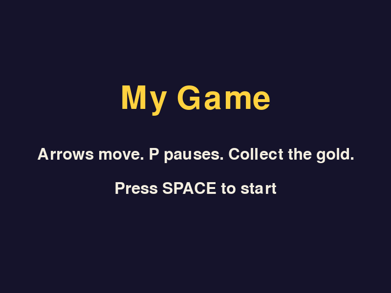
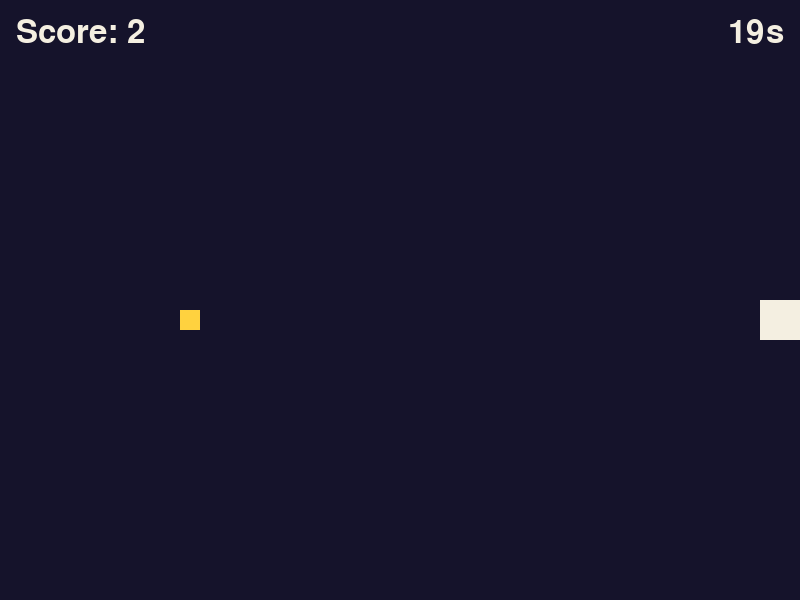
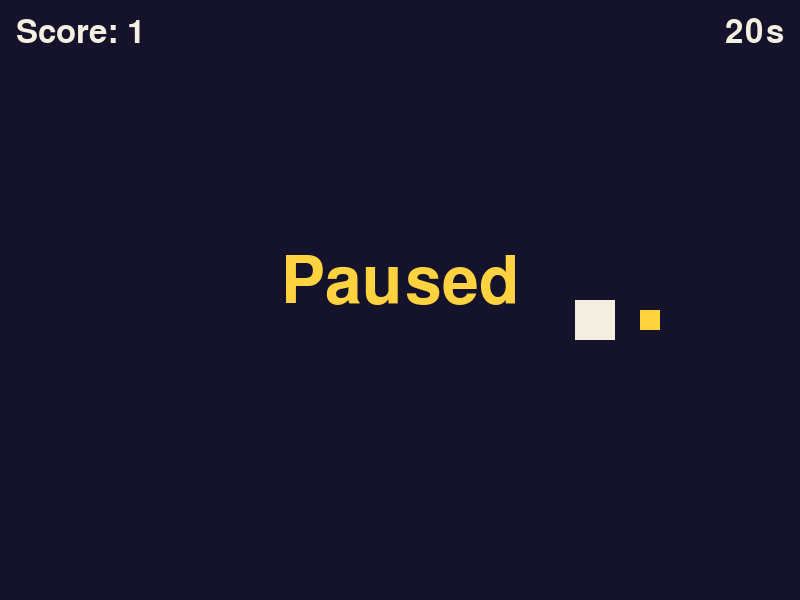

*The template's title screen. Everything on it is yours to change.*

This lesson is different. The first half builds one last thing every finished game has and none of the lesson games did: a title screen. The second half has no code to copy, because the game is yours.

You'll type the loop from an empty file one more time. Make a folder for your game, make an empty `main.py` in it, and open a terminal there.

## 1. A screen is a function

In [Extend Rain Dodge](../extend-rain-dodge/) the game-over message got its own small loop inside `game_over`. It drew once, then waited for R or for the window to close, and reported back which one happened.

That is all a screen is: **a function with its own loop that returns when it's time for a different screen.** A title screen is the same function with different words and a different key. So this time the waiting loop goes in its own function, `wait_for_key`, and every screen that only waits can use it.

The player is a small class, as in [Shoot Back](../shoot-back/). It's a square for now.

```python title="main.py" showLineNumbers file=your-own-game/step1.py
import random
import pygame

pygame.init()
WIDTH, HEIGHT = 800, 600
WIN = pygame.display.set_mode((WIDTH, HEIGHT))
pygame.display.set_caption("My Game")
CLOCK = pygame.time.Clock()
FONT = pygame.font.Font(None, 48)
BIG_FONT = pygame.font.Font(None, 96)

INDIGO = (21, 19, 43)
CREAM = (244, 239, 225)
GOLD = (255, 210, 63)

def draw_centered(text, font, color, y):
    image = font.render(text, True, color)
    WIN.blit(image, (WIDTH // 2 - image.get_width() // 2, y))

def wait_for_key(key):
    while True:
        CLOCK.tick(60)
        for event in pygame.event.get():
            if event.type == pygame.QUIT:
                return False
            if event.type == pygame.KEYDOWN and event.key == key:
                return True

def title_screen():
    WIN.fill(INDIGO)
    draw_centered("My Game", BIG_FONT, GOLD, 170)
    draw_centered("Arrow keys to move", FONT, CREAM, 300)
    draw_centered("Press SPACE to start", FONT, CREAM, 370)
    pygame.display.update()
    return wait_for_key(pygame.K_SPACE)

class Player:
    def __init__(self):
        self.rect = pygame.Rect(WIDTH // 2, HEIGHT // 2, 40, 40)
        self.speed = 5

    def update(self):
        keys = pygame.key.get_pressed()
        if keys[pygame.K_LEFT]:
            self.rect.x -= self.speed
        if keys[pygame.K_RIGHT]:
            self.rect.x += self.speed
        if keys[pygame.K_UP]:
            self.rect.y -= self.speed
        if keys[pygame.K_DOWN]:
            self.rect.y += self.speed
        self.rect.clamp_ip(WIN.get_rect())

    def draw(self):
        pygame.draw.rect(WIN, CREAM, self.rect)

def play():
    player = Player()
    while True:
        CLOCK.tick(60)
        for event in pygame.event.get():
            if event.type == pygame.QUIT:
                return
        player.update()
        WIN.fill(INDIGO)
        player.draw()
        pygame.display.update()

def main():
    if title_screen():
        play()

main()
pygame.quit()
```

Three things here are new.

- **`draw_centered`** (line 16) is the centering sum you've typed in every game-over message, written once. Give it the text, a font, a color and how far down the screen to put it.
- **`BIG_FONT`** (line 10) is a second font at twice the size, for titles.
- **`clamp_ip`** (line 52) moves a rectangle back inside another one if it has strayed outside. `WIN.get_rect()` is the whole window as a rectangle, so that one line replaces the four edge checks you would otherwise write.

`random` on line 1 isn't used yet. Step 2 needs it.

Read `main` on lines 69 to 71 as a sentence: show the title screen, and if the player pressed SPACE (and didn't close the window), play.

:::tip[Checkpoint 1]
Run it. The title screen appears and stays until you press SPACE. Then you get a cream square that moves with all four arrow keys and stops at every edge of the window. Closing the window works on both screens.

| If this happens | Do this |
| --- | --- |
| The title flashes and the square appears straight away | Line 35 should be `return wait_for_key(pygame.K_SPACE)`. Without the `wait_for_key` call nothing waits. |
| SPACE does nothing | Click the game window first. Then check line 26 compares `event.key == key`, with two equals signs. |
| The window closes when you press SPACE | Line 71, `play()`, is missing or isn't indented under the `if`. |
| `TypeError: Player.update() takes 0 positional arguments but 1 was given` | A method is missing `self` in its brackets. Lines 38, 42 and 54 all need it. |
| The square leaves the window | Line 52, `self.rect.clamp_ip(WIN.get_rect())`, is missing or is indented under the last `if`. |
:::

## 2. A round that ends

A title screen needs a game to lead to, and a game needs an ending. The template's game is the smallest one that has both: collect as many gold squares as you can in 20 seconds. You'll replace it with your own, so the point here is the shape around it.

`play` will now **return the score** when the round ends, the game-over screen will show it, and `main` will loop back to the title.

First the round length, with the other constants.

```python title="main.py" showLineNumbers startLineNumber=12 ins={4} file=your-own-game/step2.py
INDIGO = (21, 19, 43)
CREAM = (244, 239, 225)
GOLD = (255, 210, 63)
ROUND_SECONDS = 20
```

The game-over screen is the title screen with different words. Add it below `title_screen`, and update the instructions on line 33 while you're there.

```python title="main.py" showLineNumbers startLineNumber=30 mark={4} ins={9-15} file=your-own-game/step2.py
def title_screen():
    WIN.fill(INDIGO)
    draw_centered("My Game", BIG_FONT, GOLD, 170)
    draw_centered("Arrow keys to move. Collect the gold.", FONT, CREAM, 300)
    draw_centered("Press SPACE to start", FONT, CREAM, 370)
    pygame.display.update()
    return wait_for_key(pygame.K_SPACE)

def game_over_screen(score):
    WIN.fill(INDIGO)
    draw_centered("Time's up", BIG_FONT, GOLD, 170)
    draw_centered(f"You collected {score}", FONT, CREAM, 300)
    draw_centered("Press R to go back to the title", FONT, CREAM, 370)
    pygame.display.update()
    return wait_for_key(pygame.K_r)
```

Now the game itself. `new_coin` makes a gold square somewhere random, and `play` gets a coin, a score and a countdown.

```python title="main.py" showLineNumbers startLineNumber=66 ins={1-4,8-10,16,18-20,22,24-26,28} mark={11,15} file=your-own-game/step2.py
def new_coin():
    x = random.randint(0, WIDTH - 20)
    y = random.randint(60, HEIGHT - 20)
    return pygame.Rect(x, y, 20, 20)

def play():
    player = Player()
    coin = new_coin()
    score = 0
    frames_left = ROUND_SECONDS * 60
    while frames_left > 0:
        CLOCK.tick(60)
        for event in pygame.event.get():
            if event.type == pygame.QUIT:
                return None
        frames_left -= 1
        player.update()
        if player.rect.colliderect(coin):
            score += 1
            coin = new_coin()
        WIN.fill(INDIGO)
        pygame.draw.rect(WIN, GOLD, coin)
        player.draw()
        WIN.blit(FONT.render(f"Score: {score}", True, CREAM), (16, 16))
        time_text = FONT.render(f"{(frames_left + 59) // 60}s", True, CREAM)
        WIN.blit(time_text, (WIDTH - time_text.get_width() - 16, 16))
        pygame.display.update()
    return score
```

The countdown works differently from the one in [Pop](../pop/). Instead of asking the clock what time it is, it counts frames: the loop runs 60 times a second, so 20 seconds is 1200 trips round the loop, and line 81 takes one away each trip. The reason for doing it this way shows up in step 3.

`play` now has two ways to finish, and it gives back a different answer for each. If the window is closed it returns `None`, Python's value for "nothing" (line 80). If time runs out, the `while` on line 76 ends and line 93 returns the score.

Last, `main` connects the screens.

```python title="main.py" showLineNumbers startLineNumber=95 mark={2-3} ins={4-7} file=your-own-game/step2.py
def main():
    while title_screen():
        score = play()
        if score is None:
            return
        if not game_over_screen(score):
            return
```

Read it as a sentence again: for as long as the player starts a game from the title screen, play a round, stop if they closed the window, show the result, stop if they closed the window there, and otherwise go round to the title again.

Line 98 says `score is None` and not `not score` for a reason. A player who collects nothing has a score of 0, and Python treats 0 as false, so `not score` would quit the game on them.

:::tip[Checkpoint 2]
Run it. SPACE starts a round. A gold square appears, your score goes up when you touch it and a new one appears somewhere else. The number in the top right counts down from 20. At zero you see "Time's up" and your score, and R takes you back to the title screen, where SPACE starts a fresh round.



| If this happens | Do this |
| --- | --- |
| The game closes when time runs out | Line 93, `return score`, is missing. With no `return`, `play` gives back `None` and line 98 takes that as "window closed". |
| "Time's up" appears the moment you press SPACE | Line 93 is indented inside the loop. It should line up with `while`. |
| The game closes if you score 0 | Line 98 should be `if score is None:`. |
| The coin never moves when you touch it | Line 85, `coin = new_coin()`, is missing. |
| The score races up while you touch one coin | Same cause: without line 85 the same coin is counted on every frame. |
| The countdown never moves | Line 81, `frames_left -= 1`, is missing. |
:::

## 3. Pause

Pausing means the loop keeps running, so the window stays alive and keeps drawing, but nothing in the game changes. One variable does it: `paused`. The P key flips it, and everything that moves the game forward goes under `if not paused:`.

**Indent** the five lines that update the game (lines 85 to 89 below) one level deeper so they sit under the new `if`. In most editors you can select them and press Tab.

```python title="main.py" showLineNumbers startLineNumber=71 ins={6,12-14,26-27} mark={15-19} file=your-own-game/step3.py
def play():
    player = Player()
    coin = new_coin()
    score = 0
    frames_left = ROUND_SECONDS * 60
    paused = False
    while frames_left > 0:
        CLOCK.tick(60)
        for event in pygame.event.get():
            if event.type == pygame.QUIT:
                return None
            if event.type == pygame.KEYDOWN and event.key == pygame.K_p:
                paused = not paused
        if not paused:
            frames_left -= 1
            player.update()
            if player.rect.colliderect(coin):
                score += 1
                coin = new_coin()
        WIN.fill(INDIGO)
        pygame.draw.rect(WIN, GOLD, coin)
        player.draw()
        WIN.blit(FONT.render(f"Score: {score}", True, CREAM), (16, 16))
        time_text = FONT.render(f"{(frames_left + 59) // 60}s", True, CREAM)
        WIN.blit(time_text, (WIDTH - time_text.get_width() - 16, 16))
        if paused:
            draw_centered("Paused", BIG_FONT, GOLD, 250)
        pygame.display.update()
    return score
```

`paused = not paused` on line 83 flips the variable: `True` becomes `False` and `False` becomes `True`.

This is why step 2 counted frames. `frames_left -= 1` is one of the lines under `if not paused:`, so while the game is paused the countdown stops with everything else. A countdown that read the real clock would keep running behind the "Paused" sign.

Tell the player about the key. Change the instructions on line 33:

```python title="main.py" showLineNumbers startLineNumber=33 mark={1} file=your-own-game/step3.py
    draw_centered("Arrows move. P pauses. Collect the gold.", FONT, CREAM, 300)
```

:::tip[Checkpoint 3]
Run it, start a round and press P. "Paused" appears, the square stops responding to the arrow keys and the countdown holds still. Press P again and everything carries on from where it was.



| If this happens | Do this |
| --- | --- |
| The countdown keeps going while paused | Line 85, `frames_left -= 1`, isn't indented under `if not paused:`. |
| The square still moves while paused | Same for line 86, `player.update()`. |
| "Paused" flickers on and off when you press P | Line 83 must be inside the `if` on line 82. If it's level with it, the game flips `paused` on every event, including mouse movement. |
| The screen goes black while paused | Lines 90 to 95 must not be under `if not paused:`. The game still has to draw every frame. |
:::

## The finished template

<details>
<summary>Show all 110 lines</summary>

```python title="main.py" showLineNumbers file=your-own-game/step3.py
import random
import pygame

pygame.init()
WIDTH, HEIGHT = 800, 600
WIN = pygame.display.set_mode((WIDTH, HEIGHT))
pygame.display.set_caption("My Game")
CLOCK = pygame.time.Clock()
FONT = pygame.font.Font(None, 48)
BIG_FONT = pygame.font.Font(None, 96)

INDIGO = (21, 19, 43)
CREAM = (244, 239, 225)
GOLD = (255, 210, 63)
ROUND_SECONDS = 20

def draw_centered(text, font, color, y):
    image = font.render(text, True, color)
    WIN.blit(image, (WIDTH // 2 - image.get_width() // 2, y))

def wait_for_key(key):
    while True:
        CLOCK.tick(60)
        for event in pygame.event.get():
            if event.type == pygame.QUIT:
                return False
            if event.type == pygame.KEYDOWN and event.key == key:
                return True

def title_screen():
    WIN.fill(INDIGO)
    draw_centered("My Game", BIG_FONT, GOLD, 170)
    draw_centered("Arrows move. P pauses. Collect the gold.", FONT, CREAM, 300)
    draw_centered("Press SPACE to start", FONT, CREAM, 370)
    pygame.display.update()
    return wait_for_key(pygame.K_SPACE)

def game_over_screen(score):
    WIN.fill(INDIGO)
    draw_centered("Time's up", BIG_FONT, GOLD, 170)
    draw_centered(f"You collected {score}", FONT, CREAM, 300)
    draw_centered("Press R to go back to the title", FONT, CREAM, 370)
    pygame.display.update()
    return wait_for_key(pygame.K_r)

class Player:
    def __init__(self):
        self.rect = pygame.Rect(WIDTH // 2, HEIGHT // 2, 40, 40)
        self.speed = 5

    def update(self):
        keys = pygame.key.get_pressed()
        if keys[pygame.K_LEFT]:
            self.rect.x -= self.speed
        if keys[pygame.K_RIGHT]:
            self.rect.x += self.speed
        if keys[pygame.K_UP]:
            self.rect.y -= self.speed
        if keys[pygame.K_DOWN]:
            self.rect.y += self.speed
        self.rect.clamp_ip(WIN.get_rect())

    def draw(self):
        pygame.draw.rect(WIN, CREAM, self.rect)

def new_coin():
    x = random.randint(0, WIDTH - 20)
    y = random.randint(60, HEIGHT - 20)
    return pygame.Rect(x, y, 20, 20)

def play():
    player = Player()
    coin = new_coin()
    score = 0
    frames_left = ROUND_SECONDS * 60
    paused = False
    while frames_left > 0:
        CLOCK.tick(60)
        for event in pygame.event.get():
            if event.type == pygame.QUIT:
                return None
            if event.type == pygame.KEYDOWN and event.key == pygame.K_p:
                paused = not paused
        if not paused:
            frames_left -= 1
            player.update()
            if player.rect.colliderect(coin):
                score += 1
                coin = new_coin()
        WIN.fill(INDIGO)
        pygame.draw.rect(WIN, GOLD, coin)
        player.draw()
        WIN.blit(FONT.render(f"Score: {score}", True, CREAM), (16, 16))
        time_text = FONT.render(f"{(frames_left + 59) // 60}s", True, CREAM)
        WIN.blit(time_text, (WIDTH - time_text.get_width() - 16, 16))
        if paused:
            draw_centered("Paused", BIG_FONT, GOLD, 250)
        pygame.display.update()
    return score

def main():
    while title_screen():
        score = play()
        if score is None:
            return
        if not game_over_screen(score):
            return

main()
pygame.quit()
```

</details>

Save a copy of this file somewhere safe. It's the starting point for every game you make from here on.

## Plan your game

You now have every piece. What's left is deciding what to build, and that decision sinks more first games than any bug does. The usual way to fail is to plan a game that would take a studio a year. The way to succeed is to plan one you can finish in a week and then make it better.

### Say it in one sentence

Write one sentence with this shape: **you are a _thing_ that _does something_ to _reach a goal_, and _something_ gets in the way.**

- Rain Dodge: you are a ship that dodges rain to last as long as you can, and the rain keeps getting heavier.
- Coin Climb: you are a square that jumps between platforms to collect every coin, and the clock is running.

If your idea needs a second sentence, it's two games. Pick one.

### List what the player does

Under your sentence, list the verbs: move, jump, shoot, click, collect, dodge. Aim for two or three. Each verb is something you already know how to build, and this table says where you built it.

| Your game needs | You built it in |
| --- | --- |
| Something that moves with the keys and stays on screen | [Rain Dodge](../rain-dodge/), step 3 |
| Things that appear at random and move on their own | [Rain Dodge](../rain-dodge/), step 4 |
| Knowing when two things touch | [Rain Dodge](../rain-dodge/), step 5 |
| A score or a message on screen | [Rain Dodge](../rain-dodge/), step 5 |
| The game getting harder over time | [Rain Dodge](../rain-dodge/), step 5 |
| Lives | [Extend Rain Dodge](../extend-rain-dodge/), step 1 |
| A high score that is still there tomorrow | [Extend Rain Dodge](../extend-rain-dodge/), step 3 |
| Clicking on things with the mouse | [Pop](../pop/) |
| Circles, and telling whether a point is inside one | [Pop](../pop/) |
| A countdown | [Pop](../pop/), or step 2 on this page |
| Sound effects | [Pop](../pop/) |
| Something that bounces | [Brick Buster](../brick-buster/) |
| A grid of things, built with loops | [Brick Buster](../brick-buster/) |
| A way to win, not only a way to lose | [Brick Buster](../brick-buster/) |
| Gravity and jumping | [Coin Climb](../coin-climb/) |
| Walls and floors you can't walk through | [Coin Climb](../coin-climb/) |
| A level you can design by typing it | [Coin Climb](../coin-climb/) |
| Shooting | [Shoot Back](../shoot-back/) |
| Enemies that each have their own speed and health | [Shoot Back](../shoot-back/) |
| A title screen, a game-over screen, a pause key | This page |

If a verb isn't in the table, that doesn't rule it out. It means you'll be working it out yourself, so allow more time for it and bring it to a meeting if you get stuck.

### Build the smallest version first

Start from the template and work in this order. Run the game after every change, the way the checkpoints made you do.

1. **The player.** Change the `Player` class until moving feels right for your game. If your game has gravity, this is where it goes.
2. **The one thing the player deals with.** One enemy, one platform, one target. Put it in its own class with `update` and `draw`, like the enemies in Shoot Back.
3. **What happens when they meet.** This replaces the coin check on lines 87 to 89 of the template.
4. **An ending.** Change the `while` condition on line 77 and the words in `game_over_screen` to fit: out of lives, out of time, or everything collected.

At this point you have a complete game, even if it's ugly and lasts ten seconds. Everything after this is making it better: more enemies, more levels, sound, art, a high score. You can stop at any time and still have a game that works, which is the reason for doing it in this order.

### Keep it small

- **One screen.** No scrolling world, no second level, until the first one is fun.
- **Shapes before art.** Rectangles and circles are enough to find out whether the game is fun. Draw the art after you know.
- **One new thing.** Build mostly from the table above and allow yourself one thing no lesson covered.
- **Cut, don't stretch.** If you're running out of time, remove a feature. A small finished game beats a large broken one.

## Show it

Bring your game to a club meeting and let someone else play it without telling them the controls. Watch what they try first and where they get confused. It's the same test these lessons went through, and it will tell you more in two minutes than an hour of playing it yourself.

If you worked out how to do something that isn't in the table, the next member will want it too. [Add it to this site](../contributing/).
